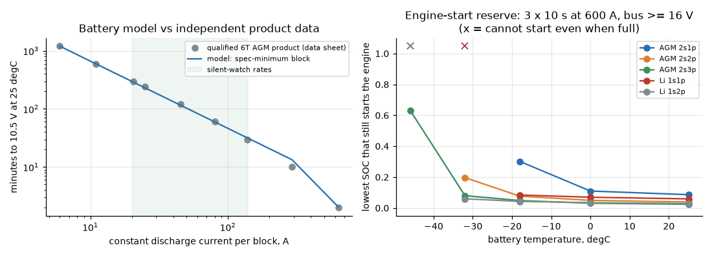
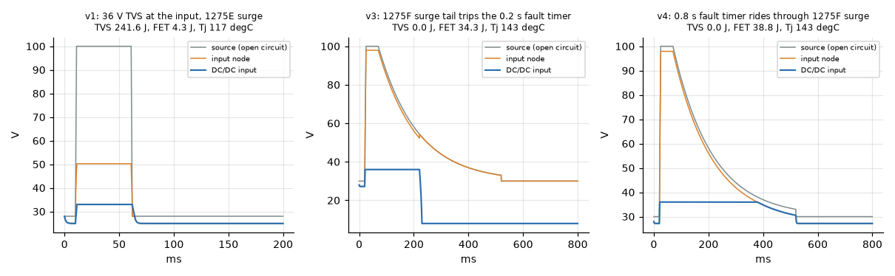
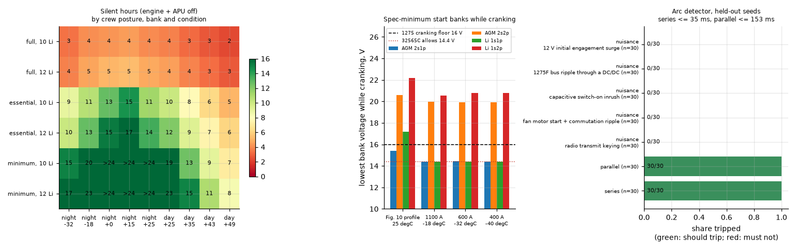
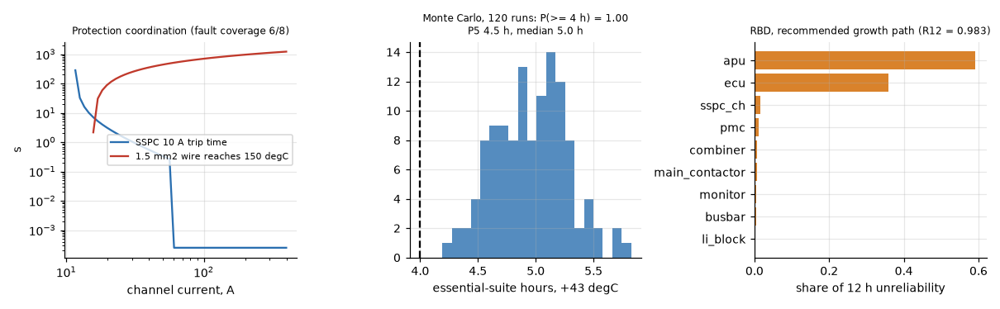
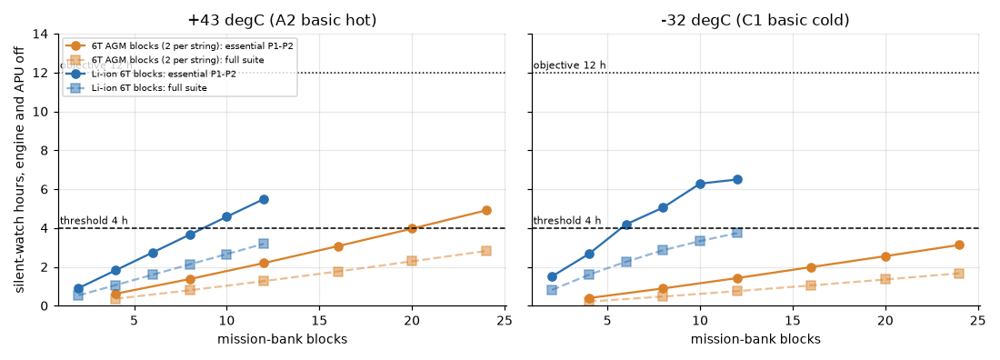
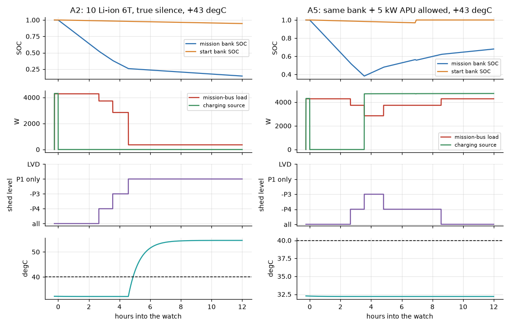
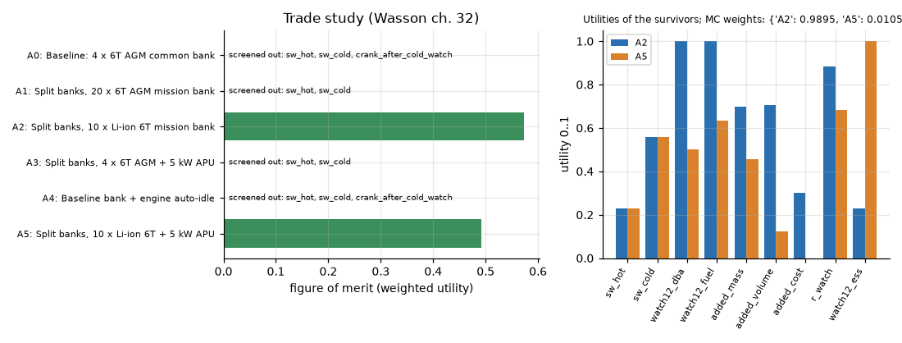

# Engineering dossier: 28 V electrical power system and silent watch of a wheeled command vehicle

Rev B, 9 Nov 2026 (Rev A the same day; Rev B adds MIL-STD-1275F and MIL-PRF-32565C, sourced thermal limits, arc-fault detection, the cranking-conflict report and the 4 h / 12 h posture study). Author: Chander Vinayak Sharma. Student engineering study; no programme, customer or product data were used beyond the public sources in section 18.

**How to read the numbers.** Every engineering value carries one of three tags, in the data files (`data/*.yaml`) and here:
**[S]** sourced: read in the cited document (section 18 key in brackets);
**[D]** derived: computed from sourced values, with the derivation given;
**[A]** assumed: an engineering assumption, listed again in section 16 and, where it matters, swept in a sensitivity run.
Wasson (2016) is cited as [W ch.x, p.N] with the printed page.

---

## 0. The question and the answer

**Central question.** What 28 V power architecture lets a 4x4/6x6 command variant run its C4ISR suite on silent watch for N hours, survive MIL-STD-1275E transients, keep its engine-start reserve and stay inside the mission-compartment thermal limit?

**N.** The threshold is **4 h** and the objective **12 h** of the essential suite with the engine and any APU off. The threshold comes from a 2022 Army briefing that sets a 4 h silent-watch mission target for a wheeled combat vehicle [GVSC2022]. The objective comes from a 2021 tank APU sources-sought notice that asks for 12 h of continuous silent watch [APU12H]. Both are argued in section 5.1.

**Answer** (numbers from `results/`, regenerated by `python -m swpower all`; tables in [docs/RESULTS.md](docs/RESULTS.md)):

1. **The architecture.** Split the batteries:
   - a **start bank of 4 x 6T AGM (2s2p)**, isolated during the watch by a voltage-sensing combiner;
   - a **mission bank of 10 x 24 V lithium-ion 6T in parallel** (MIL-PRF-32565C Class B, sub-class 90, specification-minimum; 300 kg);
   - a **16-channel SSPC panel** commanded by the load-management block `FB_PowerMgmt`, with **arc-fault detection** (`FB_ArcDetect`) on every channel;
   - a **MIL-STD-1275F front end** at each equipment input (TVS above the surge level, two surge-stopper FETs rated 250 V, a 0.8 s fault timer).

   This holds the essential suite (P1-P2: 3.3 kW at +43 degC, of which 2.1 kW is cooling to the sourced 32.2 degC compartment limit) for **4.58 h at +43 degC and 6.28 h at -32 degC**, silently, and still starts the engine. Across 120 Monte Carlo runs over the uncertain inputs: P5 = 4.47 h, **P(>= 4 h) = 1.00** (sections 10, 11).
2. **What the baseline does.** 4 x 6T AGM in one common bank: **0.61 h** at +43 degC and **0.38 h** at -32 degC, and no engine start after the cold watch.
3. **Lead-acid cannot reach the threshold at -32 degC at any practical size.** 24 blocks (978 kg) give 3.1 h, and 20 blocks miss the hot corner too (3.97 h).
4. **4 h or 12 h (results R12).**
   - True silence for 12 h is reachable without an APU **only by posture and season.** With 10 blocks, a crew that switches on only the essential suite gets 12.8-14.5 h on 0-15 degC nights. With vital loads + cooling + CBRN it gets 15-24+ h at night down to -32 degC.
   - On a +43 degC day even that minimum posture lasts 9.1 h (10.9 h with 12 blocks, the spec's parallel limit).
   - **So the 12 h objective in the heat needs a charging source.** The same bank + a 5 kW APU (A5) holds the suite for 12 h at 55 dB(A) at 7 m and 14.6 L of fuel.
   - The trade study recommends A2 (silent, FOM 0.57) over A5 (0.49), robust to every -10 % weight change and to 99 % of random weightings. It flips only if 12 h duration is rated 15 on a 1-10 scale.
5. **In the heat, the problem is thermal.**
   - Cooling to 32.2 degC draws **2.1 kW at +43 degC**, six times all vital loads.
   - The thermal model reproduces two published measured vehicle interiors (69 vs > 65 degC; 51 vs 46.5-52.8 degC). It may under-estimate the cooling load (section 8.3).
6. **The cranking conflict is real in the current specifications (IIR-01).**
   - MIL-STD-1275F guarantees users >= 16 V while cranking.
   - MIL-PRF-32565C and MIL-PRF-32143C both let a full, spec-minimum battery or pair sit at **14.4 V** at its rated cold current.
   - Resolved here by a doubled start bank (>= 19.9 V) and by keeping the combiner open during starts, so the mission bus never sees the dip.
7. **MIL-STD-1275F.**
   - The surge now lasts 500 ms (100 V for 50 ms, decaying to 33 V), and it tripped the fault timer of the 1275E-era design (v3).
   - The final front end (v4) passes all 14 E and F cases in simulation.
   - A 36 V TVS at the input would have had to absorb 64-242 J.
8. **Protection.**
   - Every SSPC channel coordinates with its wire (worst margin x1.32).
   - The I2t curve misses series and intermittent parallel arcs. The added detector trips **30/30 series arcs within 35 ms and 30/30 parallel arcs within 153 ms, with 0/150 nuisance trips**, on held-out synthetic cases (section 9.3).

**Still open:** the 4 h vs 12 h decision itself (the user's), the thermal model against a real body, cold start at C2, and hardware tests of the front end and the arc detector (section 15). Section 16 lists what is assumed versus sourced.


---

## 1. Scope, system of interest and method

**System of interest (SOI).** The vehicle electrical power system (EPS) from the alternator and the batteries to the input terminals of the mission equipment. It includes:
- the start and mission battery banks and the combiner;
- the 28 V bus and the solid-state power controller (SSPC) panel;
- the power-management controller (PMC) running `plc/FB_PowerMgmt.st`;
- an optional auxiliary power unit (APU);
- the protection front end of one mission-equipment input;
- the cooling unit as an electrical load.

The C4ISR equipment, the engine and the vehicle structure are external systems. The EPS is an *enabling system* that delivers "fitness-for-use" power to the C4ISR *mission system* [W ch.4, Principles 4.4-4.7, p. 81-84].

**Method.** The dossier follows Wasson's sequence. User needs and mission analysis come first (ch. 4-5), then the ConOps (ch. 6) and the phases, modes and states (ch. 7). Requirements derived from standards follow (ch. 19-22), then architecture and interfaces (ch. 26-27), budgets and margins (ch. 31), the trade study (ch. 32), modelling and simulation (ch. 33), reliability (ch. 34) and verification and validation (ch. 13, 28). The INCOSE handbook [INCOSE2015] and the NASA SE handbook [NASA2016] are used for process context only.

**What was built.**
- A time-domain model of the EPS: batteries, alternator, APU, the bus, loads, the thermal zone, the engine start, MIL-STD-1275E transients and SSPC/wire protection. It is in Python under `swpower/`.
- The load-management controller as an IEC 61131-3 Structured Text function block (`plc/FB_PowerMgmt.st`). It runs unchanged inside every simulation through a small ST-to-Python translator, and is exported as Siemens SCL.
- 48 tests, CI configuration, and the figures in `docs/img`.

---

## 2. User needs and problem statement (Wasson ch. 4-5)

### 2.1 Stakeholders [W ch.4, Table 4.2]

| Role | Who | Main concern |
|---|---|---|
| User | Vehicle commander and crew (4 operators in the mission compartment) | C2 nets stay up; the vehicle can always drive off; the compartment stays bearable |
| End users | Staff consuming the C4ISR products (higher HQ, neighbours) | Continuity of the command nets and data links |
| Maintainer | Field maintenance (battery swaps, LRU exchange) | Few, quick, safe tasks; batteries that are not damaged by deep discharge |
| Acquirer / integrator | The vehicle integrator building the command variant | Mass, volume, cost and integration risk of the power solution |
| System threat | Adversary ISR | Acoustic and thermal signature of a halted command post: silent watch exists to deny it [ARC2004 slide 5] |

### 2.2 Problem statement [W ch.4, Principle 4.15]

> During halted command-post operations with the engine off, the command vehicle cannot sustain its C4ISR suite for the required watch period while keeping the ability to start the engine and holding the mission compartment within its thermal limit.

*Discussion.* A typical baseline is 4 x 6T AGM in one common bank. It holds the essential suite for under one hour at +43 degC (section 10). The published record shows the same gap on fielded vehicles. A 4 kW silent-watch load on four lead-acid 6T batteries lasts 18.7 min against a 4 h target [GVSC2022 slide 7]. A tactical truck lasts "3 h @ 1 kW, 1 h @ 2.4 kW" on batteries [ARC2004]. This is a *real* need (Principle 4.12), not a perceived one.

*Five whys.* Why does the watch end early?
1. The bank is cut off.
2. Why? It reaches the floor that protects engine starting.
3. Why so soon? The C4ISR suite plus cooling draws 2-4 kW and the bank holds 3-6 kWh, of which only part is usable.
4. Why only part? Lead-acid capacity falls steeply with cold and with discharge rate, and the start reserve shares the same bank.
5. Why a shared bank? The legacy electrical system was sized for starting and driving, not for an engine-off command post.

---

## 3. Mission analysis and concept of operations (Wasson ch. 5-6)

### 3.1 Mission statement and objectives [W ch.5, Principle 5.2]

**Mission:** sustain the command post's C2 nets and data links from a halted, signature-managed vehicle for one watch period, then move.

| Objective type | Objective |
|---|---|
| Performance | Essential suite (priority 1-2 loads incl. compartment cooling) on for >= 4 h (threshold), 12 h (objective), engine and APU off |
| Mission reliability | The watch is not lost to an EPS failure: R(12 h) >= 0.98 for the EPS elements involved |
| Operating constraint | Engine start remains possible after the watch at the Basic climatic category cold extreme (-32 degC); no APU or engine run while the crew demands silence |

### 3.2 Operating environment

The design range is MIL-STD-810H's Basic climatic category, -32 degC to +43 degC air [MIL810H Annex C D.1]. A2 basic hot has a 43 degC peak with 1120 W/m2 solar [MIL810H 505.7]. The extreme categories are reported but are not design points:
- A1 hot dry: 49 degC with 1120 W/m2. The peaks do not coincide in time, so holding both together is conservative.
- C2 cold: -46 degC.

The electrical environment is MIL-STD-1275E at every equipment input [MIL1275E] and MIL-STD-461G for EMI [MIL461G].

### 3.3 Mission event timeline (MET) [W ch.5, Fig. 5.4-5.5, Principle 5.8]

The design reference mission is a 24 h command-post day (`data/mission.yaml`, profile `cp_day`):

| t (h) | Event | Phase | EPS mode |
|---|---|---|---|
| 0.0 | Cold start, crank 3 x 10 s worst case | Pre-mission | START |
| 0.0-3.0 | Road march; alternator charges both banks | Mission: move | DRIVE |
| 3.0-3.5 | Set-up halt, mast up, engine at tactical idle | Mission: set-up | HALT |
| 3.5 | Engine off; combiner opens; crew sets SILENT | Mission: watch | SILENT WATCH |
| 3.5-15.5 | Watch; the controller sheds by priority; APU only if crew allows | Mission: watch | SILENT WATCH / CHARGE (APU) |
| 15.5 | Engine start from the start bank | Mission: displace | START |
| 15.5-17.5 | Displacement; recharge | Mission: move | DRIVE |

### 3.4 Use cases [W ch.5, 13-attribute template p. 119; ch. 6 Table 6.4]

| UC | Name | Actor / trigger | Pre-condition | Main success scenario | Post-condition | Exceptions (compensating provisions) |
|---|---|---|---|---|---|---|
| UC1 | Sustain C4ISR at engine-off | Commander sets SILENT (manual) | Banks charged during the march | PMC opens the combiner; mission bank feeds the bus; SSPCs keep the requested channels | Essential suite on for >= 4 h | SOC low: shed by priority (UC2); bus sags: fast shed |
| UC2 | Shed and restore loads | PMC (automatic), on SOC / voltage / compartment temperature | UC1 running | Shed P4, then P3, then P2, one level per 10 s; restore only with a source and 10 % hysteresis | Vital suite kept to the floor | SOC estimate wrong: the voltage-based shed acts independently |
| UC3 | Start the engine from the reserve | Driver (manual) | Start bank isolated during the watch | 3 x 10 s at 600 A with the bus >= 16 V | Engine running, combiner closes after 5 s at >= 26.4 V | Cold soak at -46 degC: pre-heat (allocated outside the EPS) |
| UC4 | Charge from APU | PMC request + crew permission | APU fitted, SILENT not demanded | APU starts at shed level 2 or usable SOC < 35 %, stops at 95 % | Watch extended to 12 h+ | APU fails to start: battery-only watch (UC1) |
| UC5 | Accept external power | Maintainer, NATO slave receptacle | Vehicle parked | Charge both banks | Banks full before mission | not modelled |
| UC6 | Report power health | PMC (continuous) | Any mode | Shed level, hours to reserve, alarms, tripped channels | Crew informed | Display loss: SSPC panel LEDs |
| UC7 | Clear an SSPC trip | PMC / crew | Channel tripped | Vital channel: one automatic retry after 5 s; others latch; crew Reset | Channel restored or latched | Repeated trip: latched, crew moves the load to a spare channel |

### 3.5 ConOps summary [W ch.6, Table 6.1]

- **Deployment.** The EPS goes into the command variant at integration. The batteries are 6T form factor [MIL32143C][MIL32565], so they share racks, terminals and logistics with the fleet.
- **Operations.** As in the MET and the use cases. The crew sees the shed level, the hours to the reserve and alarms (UC6).
- **Maintenance.** At field level: battery block swap, SSPC panel LRU swap and front-end LRU swap. Li-ion blocks report SOC/SOH over CAN [MIL32565 3.6.5].
- **Storage.** Lithium-ion blocks at 100 % SOC must stay above 20 % after 2 years at 22 +/- 5 degC [MIL32565 3.5.9]. AGM retains >= 200 min of reserve capacity after 90 days at 40 degC [MIL32143C Table I].

---

## 4. Phases, modes and states (Wasson ch. 7)

Wasson separates **modes** (the operator-selected configurations of capabilities) from **states** (the conditions the system is in within a mode) [W ch.7, p. 148]. He also warns against mixing the two vocabularies (Author's Note 7.1).

### 4.1 Phases of operation
Pre-mission (charge, checks), Mission (move, set-up, watch, displace) and Post-mission (recharge, report). The non-operational phases are Deployment, Maintenance and Storage [W ch.5, Principle 5.7; ch.6 Author's Note 6.1].

### 4.2 Modes of the EPS

| Mode | Engine | Combiner | Charging source | Loads |
|---|---|---|---|---|
| OFF / STORAGE | off | open | none | keep-alive only |
| START | cranking | open | none (start bank) | mission bus held by the mission bank |
| DRIVE | running | closed | alternator | drive-mode suite |
| HALT | tactical idle | closed | alternator | full suite |
| SILENT WATCH | off | open | none | full suite, shed by state |
| CHARGE (APU) | off | open | APU | full suite + recharge |
| MAINTENANCE | off | per task | external | per task |

### 4.3 States inside SILENT WATCH and CHARGE (the controller's state variable `ShedLevel`, plus `LvdActive`)

| State | Loads on | Entry | Exit |
|---|---|---|---|
| S0 all | P1-P4 | usable SOC >= 50 % | usable SOC < 50 % for 10 s -> S1 |
| S1 shed comfort | P1-P3 | usable SOC < 50 % | < 35 % for 10 s -> S2; with a source and >= 60 % for 60 s -> S0 |
| S2 shed deferrable | P1-P2 | usable SOC < 35 %, or compartment > 55 degC | < 22 % for 10 s -> S3; source and >= 45 % for 60 s -> S1 |
| S3 vital only | P1 | usable SOC < 22 % | reserve reached -> LVD; source and >= 32 % for 60 s -> S2 |
| LVD | none | SOC <= reserve, or bus < 21 V for 10 s, engine off | source on and SOC > reserve + 5 %, or Reset with SOC above reserve |

Usable SOC = (SOC - reserve) / (1 - reserve). The thresholds therefore work for a split bank (reserve = depth-of-discharge floor) and for a common bank (reserve = engine-start reserve) without retuning. This was found in simulation: with the absolute thresholds, a common bank reached its 62 % start reserve before any shed and simply switched everything off (DOSSIER 10.2). The fast under-voltage shed (bus < 23 V for 5 s) adds one level per sag event, whatever the SOC.

### 4.4 Allowable / prohibited actions [W ch.7, Fig. 7.14, Principle 7.10]

| Action | DRIVE | HALT | SILENT WATCH | CHARGE (APU) | LVD |
|---|---|---|---|---|---|
| APU automatic start | n/a | n/a | **prohibited** while SILENT is demanded | allowed | allowed if crew allows |
| Discharge the start bank for mission loads | prohibited | prohibited | **prohibited** (combiner open) | prohibited | prohibited |
| Restore shed loads | allowed | allowed | **prohibited** without a source | allowed (hysteresis) | prohibited |
| Run the cooling unit | allowed | allowed | allowed (P2) | allowed | prohibited |
| Close the combiner | allowed (after 5 s >= 26.4 V) | allowed | prohibited | prohibited | prohibited |

These rows are implemented in `plc/FB_PowerMgmt.st` and tested in `tests/unit/test_controller.py`.

---

## 5. Requirements (Wasson ch. 19-22)

### 5.1 Derivation of the key performance parameter

**KPP-1 silent-watch endurance.** The essential suite (P1-P2, including compartment cooling) shall stay powered with the engine and any APU off for >= 4 h (threshold) and 12 h (objective). This shall hold over the Basic climatic category design corners, from a fully charged state, while keeping the engine-start reserve.

- **Threshold 4 h:** the mission target for a wheeled combat vehicle's 4 kW silent-watch load [GVSC2022 slide 7].
- **Objective 12 h:** the continuous silent-watch figure in the tank APU notice [APU12H]. A TARDEC slide set is quoted in search results as "12 (O) 24 (T)" hours; it could not be opened, so it is not used.
- **Essential, not full suite:** P3-P4 (staff workstations, mast camera, data link, comfort) can be shed by design, and the controller does so.

### 5.2 Requirements table (one MOP per requirement, Wasson Principle 20.1; statement form per Principle 22.5)

Verification methods: I inspection, A analysis, D demonstration, T test [W ch.13, p. 283]. "Model" means the analysis or test runs on the validated model here; the real-hardware method is in section 14.

| ID | Requirement | Source / derivation | Condition | Verification |
|---|---|---|---|---|
| SR-01 | The EPS shall keep the essential suite (P1-P2) powered for >= 4 h (T) / 12 h (O) with engine and APU off, at -32 degC and +43 degC ambient, from full charge, keeping the start reserve. | KPP-1, [GVSC2022], [APU12H], [MIL810H] | Normal | A + T (model IT01, IT02); vehicle T |
| SR-02 | The power budget shall hold a 10 % system margin above the growth-allocated load in every mode. | [W ch.31, Fig. 31.1] | Normal | A (budget) |
| SR-10 | Every mission-equipment input shall operate without degradation from the Fig. 8 lower limit (18 V for 500 ms, then 20 V) to 33 V DC including ripple. | [MIL1275F 5.1.1.1] (governing); [MIL1275E 5.1.1.1] 20-33 V | Normal | T (model IT04); 1275F 5.3.1 |
| SR-11 | Every input shall operate through the starting events of 1275F Table I: three start attempts, IES >= 12 V for <= 1 s, the last followed by cranking >= 16 V for 30 s. | [MIL1275F 5.1.2, 5.3.2 Table I]; [MIL1275E 5.1.2, Fig. 6] | Abnormal (external) | T (model IT04) |
| SR-12 | Every input shall survive +/-250 V spikes (rise <= 50 ns): from the 1275F 8.2 uF circuit (<= 200 mJ) and, as a harsher check, the 1275E 2 J envelope. | [MIL1275F 5.1.3.1.1, Fig. 10]; [MIL1275E 5.1.3.1.1] | Abnormal (external) | T (model IT04, UT) |
| SR-13 | Every input shall operate through the 100 V surge from 500 mOhm held 50 ms and decaying to 33 V at 500 ms (1275F Fig. 12 generator), and the 18 V / 500 ms low surge. | [MIL1275F 5.1.3.2.1, Fig. 8, Fig. 12, Table II]; [MIL1275E Fig. 8, Table I] | Abnormal (external) | T (model IT04) |
| SR-14 | Every input shall withstand 33 V reverse polarity without damage and work after reconnection. | [MIL1275E 4.1, 5.3.4] | Abnormal (external) | T (model IT04) |
| SR-15 | Every input shall tolerate 4 V p-p ripple at 30 Hz-5 kHz (1275F) and, as a check, the 1275E CS101 level (126 dBuV = 2 V rms). | [MIL1275F 5.1.1.2.1]; [MIL1275E 5.1.1.2], [MIL461G CS101] | Normal | T (model IT04) |
| SR-20 | After any watch, the start bank shall crank 3 x 10 s at 600 A with 60 s rest, holding the bus >= 16 V, at battery temperatures down to -32 degC. | [MIL1275E 5.1.2.2] (16 V floor); 600 A [A] | Normal | A (model), T on vehicle |
| SR-21 | No mission load shall be able to discharge the start reserve. | Derived from SR-20 and UC1 | Abnormal (internal) | A + T (model) |
| SR-22 | Engine start at -46 degC shall be provided by a pre-heating kit outside the EPS. | Allocation, from R4 (no practical bank cranks at -46 degC) | Emergency | A |
| SR-23 | During engine starting the mission bus shall stay inside the 1275 steady-state range: the combiner shall be open, so mission equipment never sees the cranking dip; the start bank shall hold >= 16 V on the start bus with spec-minimum batteries. | IIR-01 (section 7.4), [MIL1275F 5.1.2.2], [MIL32565C Table I, 3.5.3] | Abnormal (external) | A + T (model IT08) |
| SR-30 | Every mission load shall be fed by an SSPC channel whose trip curve lies below its wire's damage curve at every current. | [SSPC-DDC], [SSPC-6136], [IEC60364] | Abnormal (internal) | A + T (model IT05) |
| SR-31 | The PMC shall shed loads in priority order P4, P3, P2, at 50 / 35 / 22 % usable SOC, one level per 10 s; P1 is never shed by SOC. | UC2; this design | Normal | T (model UT) |
| SR-32 | The PMC shall restore a level only with a source on line, 10 % above the shed threshold, after 60 s. | UC2 | Normal | T (model UT) |
| SR-33 | The PMC shall disconnect the mission bus at the reserve SOC or after 10 s below 21 V with the engine off. | SR-21; [AGM-DS1] 70 % DoD floor | Abnormal | T (model UT, IT03) |
| SR-34 | The PMC shall shed one level within 5 s when the bus falls below 23 V with no source, independent of the SOC estimate. | FMEA FM07 | Abnormal (internal) | T (model UT) |
| SR-35 | The PMC shall keep the CBRN channel on while the CBRN alarm is active. | UC1 | Emergency | T (model UT) |
| SR-36 | A tripped vital channel shall get one automatic retry after 5 s; a second trip or a non-vital trip shall latch until Reset. | UC7 | Abnormal (internal) | T (model UT) |
| SR-37 | The APU shall not start while the crew demands silence; otherwise it shall start at shed level 2 or < 35 % usable SOC and stop at 95 % SOC. | UC4; Fig. 7.14 matrix | Normal | T (model UT, IT02) |
| SR-38 | Above 55 degC compartment air, the PMC shall shed P3-P4 until it falls below 50 degC. | FMEA FM14 | Abnormal | T (model UT) |
| SR-39 | The combiner shall close only with a source on line after 5 s >= 26.4 V and open within 2 s of the source stopping or < 25.6 V. | UC3, SR-21 | Normal | T (model UT) |
| SR-40 | With the full suite and 4 operators, the cooling unit shall hold the compartment air <= 32.2 degC (90 degF) at 43.3 degC with 1120 W/m2 sun. | [ACVP-HVAC] (a published crewed-vehicle requirement); [MIL1472H] 21-25 degC design goal, WBGTeff <= 30 degC | Normal | A (thermal) |
| SR-41 | Each SSPC channel shall trip a 28 V DC series arc (loose terminal, ~15 V arc) within 100 ms of arc onset. | [ARC-WARWICK] physics; 100 ms after [AS6019 4.7.7.6.1]; FMEA FM12 | Abnormal (internal) | T (model IT07) |
| SR-42 | Each SSPC channel shall trip intermittent parallel arcs (bursts > 30 A of 2-4 ms) by the third burst within 500 ms. | [ARC-WARWICK]; [AS5692] event-count logic; FMEA FM12 | Abnormal (internal) | T (model IT07) |
| SR-43 | Arc detection shall not trip on radio transmit keying, motor start and commutation ripple, capacitive inrush, 1275F ripple or the 12 V IES. | [AS6019] nuisance tests; [ARC-NASA] 0/16 false positives | Normal | T (model IT07) |
| SR-60 | EPS reliability over a 12 h watch shall be >= 0.98 and operational availability >= 0.95. | Mission-reliability objective, [W ch.34], [MIL338B] | Normal | A (RBD, model IT06) |
| MS-01 | The battery models shall reproduce every specification rating they are built on. | [W ch.33] model credibility | - | T (UT) |
| MS-02 | The spec-minimum AGM model shall match an independent qualified product's run times within -7/+8 % over the 30 min-20 h rates. | [W ch.33], [AGM-DS1] | - | T (UT) |
| MS-03 | Every non-assumed number in the data set shall resolve to a reference. | [W Principle 19.14], P32.10 | - | I (UT, CI) |

Operating-condition coverage (Normal / Abnormal / Emergency) follows Wasson Principle 19.22 and Fig. 19.5. Every requirement traces to a test in [docs/traceability.md](docs/traceability.md), which is generated from the test markers and checked in CI.

---

## 6. Architecture (Wasson ch. 26)

### 6.1 Candidate architectures [W ch.26, Principle 26.10: record the candidates and the rationale]

| ID | Storage | Engine-start reserve | Charging in the watch | Note |
|---|---|---|---|---|
| A0 | 4 x 6T AGM, one common bank (2s2p) | controller floor = crank-reserve SOC(T) | none | legacy baseline |
| A1 | split: start 2s2p AGM + mission 2s x Np AGM | separate bank + combiner | none | same chemistry, more blocks |
| A2 | split: start 2s2p AGM + mission Np x 24 V Li-ion 6T | separate bank + combiner | none | Li-ion 6T in parallel, <= 12 per [MIL32565 Table I] |
| A3 | split, AGM mission bank + 5 kW APU | separate bank | APU on request | small battery, APU does the work |
| A4 | common AGM bank + engine auto-idle | controller floor | main engine at idle | anti-idle practice in reverse [ARMY2022] |
| A5 | A2 + 5 kW APU | separate bank | APU only when silence is not demanded | battery for silence, APU for duration |

The start bank is 2s2p in every split design. A 2s1p AGM pair cannot hold 16 V at 600 A at -32 degC even when full (section 10.2), so the "cheap" split with one start pair is not viable.

### 6.2 Selected architecture (from the trade study, section 11)

```
 alternator 570 A ---+--------------------+--------------------- 28 V mission bus ---- SSPC panel (16 ch) --- loads P1..P4
 (engine driven)     |                    |                          |                    |  (I2t, inst. trip, arc)
                     |   combiner (VSR)   |                          |                    +-- ch14 cooling unit (300 A ch.)
                start bank  <--- PMC --->  mission bank         [5 kW APU, A5 only]       |
             4 x 6T AGM (2s2p)   cmd     10 x Li-ion 6T 24 V                               each equipment input:
             -> starter                  (1s10p, BMS each)                                 1275F front end v4
                     ^                          ^
                     +---- battery monitors / BMS CAN ----> PMC (FB_PowerMgmt) <---- compartment temperature
```

**Control (MC2, [W ch.26, §26.4]).** The PMC is a single controller hosting `FB_PowerMgmt`. It reads the bus voltage, the mission-bank SOC from the Li-ion BMS, the compartment temperature, the source status and the SSPC trip flags. It commands the 16 SSPC channels, the combiner and the APU request, and reports shed level, hours to reserve and alarms to the crew display (UC6). The crew sees only what it must act on (Principles 26.12-26.14).

**Fault tolerance [W ch.26, §26.5, Principle 26.19: normal, abnormal and emergency power].**
- **Normal power:** the alternator, or the APU when allowed.
- **Abnormal:** the mission bank alone, with load shedding.
- **Emergency:** vital loads only, down to the reserve.
- **If the PMC itself stops (FM08):** the SSPC panel falls back to default states, P1 on and others off. The BMS cut-off is the last protection.

The start bank is physically and electrically separated from the mission bank, so no mission-side fault drains it (SR-21). The exceptions are a welded combiner (FM05) and keep-alive drain (FM03), both covered in section 12.

---

## 7. Interfaces (Wasson ch. 27)

### 7.1 Interface register [W ch.27, Principle 27.3]

| ID | Source -> destination | Type | Defined by |
|---|---|---|---|
| IF-01 | 28 V mission bus -> every C4ISR input | electrical power | MIL-STD-1275E (all of 5.1); this dossier SR-10..SR-15 |
| IF-02 | Start bank -> starter / engine ECU | electrical power | SR-20 (600 A, >= 16 V) |
| IF-03 | Alternator -> bus | electrical power | regulator 28.0 V at 25 degC, -36 mV/K [A]; 25-30 V charging range for 6T pairs [MIL32143C 3.3] |
| IF-04 | Li-ion 6T BMS -> PMC | data (CAN) | SOC (+/-5 %), SOH, temperature, max discharge power [MIL32565 3.6.5, Table IV] |
| IF-05 | PMC <-> SSPC panel | data | channel on/off, trip flag, reset pulse, current (FB_PowerMgmt I/O, below) |
| IF-06 | Cooling unit -> compartment air | thermal | SR-40; rated 6 kW [ECU-OVR] |
| IF-07 | CBRN unit -> compartment | air (170 m3/h filtered) | [CBRN]; doubles as ventilation (UA_vent = 57 W/K [D]) |

### 7.2 IF-01 in IRS form (operational / behavioural / physical) [W ch.27, Example 27.1 logic]

| Characteristic | Value | Source |
|---|---|---|
| Steady state | 20-33 V incl. ripple | [MIL1275E 5.1.1.1] |
| Ripple | CS101 curve 2: 126 dBuV (2.0 V rms) to 5 kHz, falling to 96.5 dBuV at 150 kHz | [MIL461G Fig. CS101-1], [MIL1275E 5.1.1.2] |
| Starting | IES >= 12 V <= 1 s, IES >= 1 s apart; cranking >= 16 V <= 30 s | [MIL1275E 5.1.2] |
| Spikes | +/-250 V, 70 us envelope, rise <= 50 ns, <= 2 J injected; <= 125 mJ emitted | [MIL1275E 5.1.3.1] |
| Surges | 100 V for 50 ms decaying to 33 V at 500 ms; 18 V for 500 ms; 500 mOhm; <= 60 J | [MIL1275E Fig. 8, Table I] |
| Reverse polarity | 33 V for 5 min; reverse current <= normal operating current | [MIL1275E 4.1, 5.3.4] |
| Revision | **F (7 Sep 2022) governs** and was read from DLA ASSIST [MIL1275F]. Against E: same 33 V upper limit, 12 V IES, 16 V cranking, +/-250 V spikes and 100 V / 500 mOhm surge; new lower limit per Fig. 8; ripple 4 V p-p at 30 Hz-5 kHz instead of CS101; spike energy 200 mJ from a defined 8.2 uF circuit instead of 2 J; surge from a defined two-stage generator; a six-step starting test; tolerance +/-5 %. | Principle 22.19 (cite by revision) |

### 7.3 IF-05: FB_PowerMgmt data interface (IDD)

| Signal | Dir | Type | Unit / range | Meaning |
|---|---|---|---|---|
| VBus | in | REAL | V | mission bus voltage |
| SocMB | in | REAL | 0..1 | mission bank SOC (BMS) |
| TBay | in | REAL | degC | compartment air |
| PLoadW | in | REAL | W | measured mission load |
| ChargeOK | in | BOOL | - | engine or APU on line |
| CbrnAlarm, AutoStartEn, SilentReq, Reset | in | BOOL | - | crew / CBRN inputs |
| SocReserve, UsableWh, CbrnCh, Prio[1..16] | in | config | - | set at power-up |
| ChReq[1..16], ChTrip[1..16] | in | BOOL | - | crew request, SSPC trip status |
| ChOn[1..16], ChResetCmd[1..16] | out | BOOL | - | SSPC command, one-scan reset pulse |
| ShedLevel | out | INT | 0..3 | state of section 4.3 |
| LvdActive, CombinerCmd, ApuStartReq | out | BOOL | - | |
| LowSocWarn, ReserveAlarm, BayHot | out | BOOL | - | crew alarms |
| HoursLeft | out | REAL | h | (SOC - reserve) x usable Wh / load |

### 7.4 Interface findings

**IIR-01: the 28 V cranking floor (interface issue report, two-stage interface control [W ch.27])**

| Field | Content |
|---|---|
| Interface | IF-01 / IF-02: the 28 V bus during engine starting |
| Documents in conflict | MIL-STD-1275F 5.1.2.2 guarantees every utilization input >= 16 V while cranking [MIL1275F]. MIL-PRF-32565C w/Amd 2 (the current Li-ion 6T spec) sets the battery's minimum cranking voltage below 0 degC at **14.4 V** for every type, and 3.5.3 says the battery complies with MIL-STD-1275 "except minimum cranking voltage as defined in table I" [MIL32565C]. The carve-out is deliberate and survives into the current revision. |
| Also affected | The 6T AGM specification permits the same 14.4 V per 24 V pair: 7.2 V per block at its rated cold-cranking current [MIL32143C Table I]. |
| Quantified (results R13) | A full spec-minimum bank cranking at its rated cold current ends at exactly the spec floor. The **single Li-ion 6T and the 2s1p AGM pair both reach 14.4 V** at -18, -32 and -40 degC, 1.6 V below what 1275 users are qualified for. At 25 degC with the vehicle starting-current profile of 32565C Fig. 10 (2000 A for 0.1 s, ramping to 1100 A at 0.6 s, held to 30 s), the AGM pair reaches 15.4 V, also below 16 V. |
| Effect | Any 1275-qualified equipment on a shared bus may reset or drop out during a cold start (1275 only guarantees operation at >= 16 V for 30 s and 12 V for 1 s). The engine ECU and vehicle electronics on the start bus see the same dip. |
| Options | (a) Qualify every bus user to 14.4 V for 30 s (cost on every LRU). (b) Double the start bank (2s2p AGM: >= 19.9 V; two Li-ion 6T in parallel: >= 20.5 V). (c) Decouple the buses: keep the combiner open while cranking so the mission bus never sees the dip. (d) Boost pre-regulators on the start-bus electronics. |
| Resolution in this design | **(b) + (c):** a 2s2p AGM start bank (>= 19.9 V in every case) **and** the combiner open during starting (SR-23). The PMC opens the combiner within 2 s of the source stopping (SR-39), so during a start the mission bus is fed by the mission bank alone and stays inside the steady-state range. |
| For a programme | Raise the conflict formally with the battery specification's preparing activity and write the chosen option into the vehicle ICD. A single Li-ion 6T as the only starting battery of a 1275 vehicle is not compatible below 0 degC without option (a). |

Further findings:
2. **The 100 V surge cannot be clamped by a TVS at the bus.** A clamp at 36 V behind a 500 mOhm source must absorb 64-242 J (section 8.5), so the input has to block the surge with a series element. Under 1275F the surge lasts 500 ms, not 50 ms (section 8.5).
3. **Cooling is a power-system load, not an HVAC afterthought.** At +43 degC the cooling unit draws more than the whole priority-1 suite (section 8.3).

---

## 8. Performance budgets, margins and the physics behind them (Wasson ch. 31)

Wasson splits each capability into a design-to value and a margin, holds the reserve at the higher level, and warns against stacking margins level by level (the "14.5-unit" example, [W ch.31, Fig. 31.1, p. 669-671]). Here:
- every load carries a **growth allowance** by maturity: COTS 5 %, modified 15 %, new 25 % [A];
- the EPS owner holds one **10 % system margin** [W Fig. 31.1 uses 10 %], which is never allocated to an item.

Wasson does not prescribe a schedule for releasing margins. The rule used here, releasing the growth allowance item by item as each item is measured on the bench, is the author's addition.

### 8.1 Load inventory and power budget

16 SSPC channels feed 18 load items (`data/loads.yaml`). The power states come from published equipment data, cited by class:
- **50 W VHF amplifier:** Rx 65 W, Tx 450 W max [VHFPA]. Cross-checked against a dual 50 W set at 1.4 A receive and 13.9 A dual transmit [CERDEC2007].
- **150 W HF amplifier:** 28 V x 20 A max [HFPA].
- **Satellite C2 terminal:** 0.5 / 2.9 / 20 A [CERDEC2007].
- **Mission computer:** 45-150 W [MCOMP].
- **Display:** 50 W [DISPLAY].
- **INS:** 15 W [INS].
- **Switch:** < 20 W [SWITCH].
- **Mast EO/IR:** 0 / 6 / 15 A [CERDEC2007].
- **Data link:** 130 W max [HCLOS].
- **Remote weapon station:** 4 / 18 / 36 A [CERDEC2007].
- **CBRN fan:** 510 W max at 120 V AC [CBRN]. 150 W vent / 300 W filter are derived from its airflow and pressure drop.

The duty cycles (e.g. 10 % transmit on the command net) are **assumed** and swept in the Monte Carlo of section 10.5.

| Mode | Current best estimate | + growth | Allocated (+10 % margin) | Coincident peak |
|---|---|---|---|---|
| Drive | 1784 W | 1903 W | 2094 W | 3599 W |
| Halt / silent watch (before cooling) | 1988 W | 2148 W | 2363 W | 4027 W |

Silent-watch load by priority, with growth: **P1 360 W, P2 791 W (+ cooling), P3 640 W, P4 357 W.** Full table: [docs/RESULTS.md R1](docs/RESULTS.md).

### 8.2 Batteries: models built on their specifications

**Design to the specification, not to the brochure.** A fleet battery can be any qualified product, so the model block is one that *just meets* its military specification:
- **6T AGM** to MIL-PRF-32143C Table I: 12 V, 120 Ah at 6 A, 230 min reserve at 25 A, 1100 A for 30 s to 7.2 V at -18 degC, 400 A at -40 degC, 2 +/- 0.6 mOhm, <= 40.75 kg.
- **Li-ion 6T** to MIL-PRF-32565C w/Amd 2 (the current revision), Class B, sub-class 90 (types 1-B90 / 2-B90; identical values to the base revision's Type 3 [MIL32565C][MIL32565]): 24 V, 90 Ah at the 1 h rate, <= 30 kg, cranking 1100 / 600 / 400 A for 30 s at -18 / -32 / -40 degC to >= 14.4 V, 180 A continuous discharge, 90 A charge, at most 12 in parallel and no series connection.

Model (first-order Thevenin per block, `swpower/battery.py`):
- **OCV(SOC):** linear 11.8-12.9 V for AGM (12.9 V full [AGM-DS1], 11.8 V empty [A]). For Li-ion, a typical LiFePO4 curve x 8 cells [A]; the spec does not fix the chemistry.
- **Peukert exponent** k = 1 + ln(120/95.8)/ln(25/6) = **1.1575** [D], from the two capacity ratings.
- **Capacity vs temperature:**
  - AGM: the mean of two data sheets to -18 degC, 50 % at -18 degC [AGM-DS2][AGM-DS3]. Below that it is extrapolated: 30 % at -32 degC and 15 % at -46 degC [A].
  - LiFePO4: 59 / 46 / 38 % at -20 / -30 / -40 degC [LI2013].
- **R0(T):** a table of points interpolated as ln R vs 1/T. The cold points are **derived** by `tools/derive_battery_params.py`: R0 is set so the block ends the specification cranking test exactly at the specification voltage. The result:
  - AGM: 2.6 mOhm at 25 degC [S, upper tolerance], 4.89 mOhm at -18 degC, 14.25 mOhm at -40 degC [D];
  - Li-ion: 5 mOhm at 25 degC [A], 11.6 / 21.3 / 32.0 mOhm at -18 / -32 / -40 degC [D].
- **Lumped battery temperature with self-heating.** The Li-ion heater draws 1 kW per block from the block itself. This is derived from a 6T LFP brief: 32 Ah at 12 V to heat from -40 to +20 degC in 0.40 h [LFP6T-BRIEF]. The heater holds the cells at -10..0 degC. No charge is accepted below 0 degC [MIL32565 3.3.5.2.3 d].

**Credibility (M&S validation, [W ch.33]):**
- Both blocks reproduce every rating they are built on (MS-01, 8 of 8).
- *Independent* check (MS-02): the spec-minimum AGM model was compared with the run-time table of a qualified 6T AGM product it was not fitted to [AGM-DS1]. The model is within **-4 % to +6 %** from 30 min to 20 h, the silent-watch range. At the 10 min rate it overestimates by 34 %: Peukert's law does not hold at high rates. The 10 min rate is outside the use range except for cranking, and cranking is checked against the CCA rating instead.



### 8.3 Thermal budget of the mission compartment

One air zone holds the racks and four operators (`swpower/thermal.py`). Heat paths:
- equipment heat = electrical input minus radiated RF;
- crew sensible heat, 75 W each [ASHRAE];
- roof solar gain through the sol-air temperature T_sa = T_amb + alpha G / h_o (alpha 0.7, h_o 20 W/m2K [A]);
- conduction through a lined armour shell, UA 40 W/K [A];
- the CBRN unit's 170 m3/h of filtered fresh air, UA_vent = 1.2 x 1005 x 170/3600 = **57 W/K** [D from CBRN].

The cooling unit is rated 6 kW [ECU-OVR]. Its COP passes through **1.5 at 51.7 degC outside / 32.2 degC inside**, the one published military figure found (a 5-ton military ECU [ECU-5T]). Above 25 degC the curve is assumed to rise to 2.6 at 25 degC, inside the 1.4-2.0 range derived from electric-compressor vehicle units at hot rating points [ECU-OVR].

**The compartment limit is sourced, not assumed.** The first issue of this dossier used 40 degC. That is above the MIL-STD-1472H HVAC design goal of 21-25 degC [MIL1472H]. The published requirement of a crewed armoured vehicle is interior air below **90 degF (32.2 degC) at 110 degF (43.3 degC) with 1120 W/m2 sun** [ACVP-HVAC], and it is now SR-40. The hot-dry case is also corrected. The 49 degC air peak of the hot-dry cycle comes with 730 W/m2, and the 1120 W/m2 solar peak with 44-47 degC air [MILHDBK310], so A1 is now 49 degC with 730 W/m2.

| Climate | Uncooled compartment | Cooling to hold 32.2 degC | Cooling-unit electrical draw |
|---|---|---|---|
| A1 hot dry, 49 degC, 730 W/m2 | 72 degC | 3901 W | **2675 W** |
| A2 basic hot, 43 degC, 1120 W/m2 | 68 degC | 3483 W | **2133 W** |
| 25 degC night | 45 degC | 1266 W | 737 W |
| -32 / -46 degC | -12 / -26 degC | 0 | 0 (heater electrics 90 W [A]) |

**Plausibility check against measured vehicles (not a validation: none of these is this vehicle).**

| Published measurement | Model set up the same way |
|---|---|
| Tracked vehicle buttoned up, no AC, outside air near 50 degC in the sun: interior **above 65 degC** [CAJ2008] | Closed, crew of 4, no ventilation, no electronics, 50 degC / 1120 W/m2: **69 degC** |
| Armoured vehicle, hatches open, blowers only, 40.4-43.5 degC outside: interior **46.5-52.8 degC** [IJB1995] | Crew of 4, 170 m3/h ventilation, no electronics, 43.5 degC / 1120 W/m2: **51 degC** (hatches give more air, so the model should sit at the top of the range, and it does) |
| Crewed amphibious vehicle, 16 occupants incl. 2.8 kW electronics: about **16 kW** of cooling at 43.3 degC [ACVP-HVAC] | 4 occupants, 1.7 kW electronics, a smaller shell: **3.5 kW**. Scaled by occupants and electronics the published figure suggests 5-6 kW for this case, so the model may **under**-estimate the cooling load. The 6 kW unit still covers it. |

The thermal model therefore reproduces the two measured interiors. It may be optimistic on cooling load, and that would shorten the hot-climate watch further. This is the largest remaining modelling uncertainty (section 15).

**Finding.** At +43 degC the cooling unit draws **2.1 kW**, six times all P1 loads together (0.36 kW). The silent-watch problem in the heat is mostly a *thermal* problem. Cooling is therefore priority 2. With it at P3, the controller shed it at level 2, the compartment heated, and BayHot forced level 2 anyway. That oscillation was seen in the first simulation runs and removed by the priority change.

### 8.4 Engine-start reserve

`analysis.crank_reserve_soc` bisects on SOC for the lowest state of charge from which a bank still passes SR-20 at a given temperature (results R4):

| Start bank | 25 degC | -18 degC | -32 degC | -46 degC |
|---|---|---|---|---|
| 2 x AGM (2s1p) | 0.09 | 0.30 | **cannot start when full** | cannot |
| 4 x AGM (2s2p) | 0.04 | 0.08 | **0.20** | cannot |
| 6 x AGM (2s3p) | 0.02 | 0.05 | 0.08 | 0.63 |
| 1 x Li-ion 6T | 0.06 | 0.08 | cannot | cannot |
| 2 x Li-ion 6T | 0.03 | 0.04 | 0.06 | cannot |

**Consequences.**
- The start bank must be 2s2p AGM, or two Li-ion 6T in parallel, to meet SR-20 at -32 degC. Note that two Li-ion 6T can only crank to >= 16 V because two share the current; the 1275E/32565 floor conflict in section 7.4 still applies to a single block.
- At -46 degC no practical bank cranks from partial charge without pre-heating. That requirement is allocated outside the EPS (SR-22).
- For a common bank, the controller floor becomes max(crank reserve + 5 %, the 30 % AGM depth-of-discharge floor from the 70 % DoD rating [AGM-DS1]). That costs most of the bank.

A second finding came from the long cold runs. During a 16 h watch at -32 degC, 30 W of keep-alive load on the start side removes about 0.3 SOC from a 2s2p AGM bank, because its capacity is only 30 % of rated at that temperature. The reserve must include the keep-alive drain for the planned watch (FMEA FM03).

### 8.5 MIL-STD-1275E protection front end

One equipment input (150 W DC/DC, 9-36 V wide-input class [A]) is simulated with:
- a source impedance per test case;
- a bidirectional TVS;
- a series N-FET acting as ideal diode, surge stopper and current limiter, with a fault timer;
- a 2.2 mF hold-up capacitor;
- a one-pole FET junction thermal model.

`swpower/transient.py` integrates node A implicitly (bisection) and node B by backward Euler. The cases are the 1275E envelopes of `data/transients.yaml`; wave shapes inside an envelope are this project's choice and are stated per case.

| Design | 1275E surge (100 V, 50 ms) | 1275F surge (100 V 50 ms, decaying to 33 V at 500 ms) | Spikes (1275E 2 J; 1275F 8.2 uF) | Starting (E Fig. 6; F Table I) | Verdict |
|---|---|---|---|---|---|
| v1: 36 V TVS at the input | TVS absorbs 64-242 J (rating 3 J) | - | the input reaches 135-142 V, above a 100 V FET's derated limit | ok | fails |
| v2: TVS 122 V, 200 V FET | ok, Tj 125 degC; **Tj 203 degC** if 100 V is held for 50 ms | - | ok | ok | fails the E envelope |
| v3: v2 + two FETs in parallel, clamp 36 V | ok, Tj <= 138 degC | **fault timer (0.2 s) trips at 200 ms, DC/DC drops out** | E ok; F drives the input to 172 V, over 0.8 x 200 V | ok | passes E, **fails F** |
| **v4: v3 + 0.8 s fault timer, 250 V FETs** | ok | ok: 38.8 J in the FETs, Tj 143 degC, no dropout | ok: TVS 0.15-0.20 J, input <= 172 V | ok: DC/DC >= 11.6 V | **passes all 14 E and F cases** |

The longer fault timer is a trade. A regulator that fails high and holds the bus above the 36 V clamp now keeps the FETs in linear mode for 0.8 s before they open. The FET thermal shutdown and the bus over-voltage alarm (FMEA FM16) must cover that case.

Two notes on the final design:
- The reverse-polarity case drops the DC/DC out while reversed. That is allowed: 1275E 4.1 asks only for no damage and normal operation after reconnection.
- The 12 V initial engagement surge needs a wide-input DC/DC (>= 9 V start): a 1 s hold-up at 150 W would need 2 x 150 x 1/(28^2 - 16^2) = **0.57 F** [D], which is not practical.



---

## 9. Power distribution and load management

### 9.1 The controller (`plc/FB_PowerMgmt.st`)

`plc/FB_PowerMgmt.st` is an IEC 61131-3 function block of about 200 lines. It implements the states of section 4.3 and the actions matrix of section 4.4, plus:
- trip handling (UC7);
- the voltage-sensing combiner;
- the APU request with SOC hysteresis;
- the hours-to-reserve estimate.

It is the code under test. `swpower/stlang.py` translates the ST subset it uses into Python. That covers VAR sections, arrays, TON, R_TRIG, IF/CASE and FOR (FOR was added for this project), plus IEC integer division. Every simulation calls the block once per time step. The same source is exported as Siemens SCL (`plc/FB_PowerMgmt.scl`). CI fails if the SCL file is stale. It has not been compiled in TIA Portal (no licence in CI).

Tests (`tests/unit/test_controller.py`, 14 tests) cover:
- shed order and the 10 s debounce;
- one level per step;
- restore with source and hysteresis;
- the usable-band thresholds;
- reserve LVD and its restore;
- the voltage LVD;
- the fast under-voltage shed;
- the CBRN hold;
- vital retry and latch, and the non-vital latch;
- the APU and silence;
- compartment over-temperature;
- the combiner.

A 5,000-scan random-input fuzz checks the invariants on every scan:
- no channel on while LvdActive;
- no channel on while latched;
- no unused channel on;
- no channel above the allowed priority unless it is the CBRN channel in alarm.

### 9.2 SSPC channels and wiring

Each channel is rated at the next standard rating >= 1.25 x its steady peak current at 20 V, the lowest 1275E steady voltage. The trip curve has this form [SSPC-6136][SSPC-DDC]:
- no trip <= 115 %;
- I2t with thermal memory, 2 x I_n in 3 s [A];
- instant trip at 6 x I_n in 250 us.

The wire is the smallest cross-section whose damage curve stays above the trip curve at every current. The wire model is a first-order conductor. Its steady current to 150 degC comes from I^2 R'(T) = h pi d (T_max - T_a), with h = 8 W/m2K and a 70 degC ambient [A]. Its short-time limit is the adiabatic I^2 t = k^2 S^2 with k = 143 [IEC60364]. Results R8:
- All 16 channels coordinate. The worst damage-to-trip time ratio is **1.32**, on the 10 A computer channels with 1.5 mm2 wire.
- The cooling unit needs a **300 A channel and 120 mm2** cable at its hot-climate peak. In practice it belongs on its own contactor, not on a panel SSPC.

**Fault coverage of the I2t curve alone (results R8): 6 of 8** fault types are cleared before the wire is damaged, or flagged:
- bolted short, chafe to chassis, stalled fan, 150 % and 120 % overload, and open circuit (by the undercurrent flag).
- **Not covered:** the series arc / high-resistance joint (current falls, so nothing trips) and the intermittent parallel arc (5 ms bursts below the I2t threshold).

These two are fire risks that an I2t SSPC cannot see, so they get their own detector (section 9.3).

### 9.3 Arc-fault detection (closes FMEA FM12)

**Why the SSPC curve cannot see it.**
- A loose terminal on a 28 V circuit arcs at about **15 V**. Each arc lives about **2 ms** before it goes out and re-strikes [ARC-WARWICK]. With a resistive load the current *falls* (by about 54 % in the measured case). With a constant-power DC/DC load it *rises*, because the load draws more current at the lower voltage. Either way it never approaches the I2t threshold.
- A chafed wire touching structure makes **parallel arcs of more than 50 A at about 20 V** [ARC-WARWICK]. They come in bursts of a few ms, too short to fill the I2t memory, and on a 35-75 A channel they stay below the instantaneous trip.
- Copper needs at least 13 V and 0.43 A to sustain an arc [ARC-RELAY], so a 28 V bus can sustain one.

**Design.** The signal processing would run in the SSPC's signal processor: `swpower/arcfault.py` at 200 kS/s. It produces three features per 1 ms frame:
- the 5-20 kHz band envelope normalised by the frame current (the band of the NASA 28 V detector [ARC-NASA]);
- the count of current dips (extinctions) of >= 20 us below 30 % of the frame mean;
- the time above 2 x the 100 ms running mean and above 30 A (bursts).

The decision logic is a second IEC 61131-3 block, `plc/FB_ArcDetect.st`, scanned once per frame:
- **series arc:** band energy **and** dips together, integrated with a leak, trip at a score of 10;
- **parallel arc:** three separate bursts inside 500 ms.

A steady in-band ripple (motor commutation, radio modulation, 1275F bus ripple) has energy but no dips, and a load step or an inrush has neither, or only one burst. The current is required above 0.5 A, since copper cannot sustain an arc below about 0.43 A.

**Requirements.**
- SR-41: series arcs within 100 ms, the trip time of the 28 V DC arc-fault breaker standard's dry-arc test [AS6019].
- SR-42: parallel arcs by the third burst within 500 ms, an event-count rule in the manner of [AS5692].
- SR-43: no nuisance trips.

**Method and result (results R14).**
- The signal library is synthetic and its noise amplitudes are assumed. Every case class is built from the published physics above. The nuisance classes are radio transmit keying with in-band modulation ripple, fan motor start with commutation ripple, capacitive switch-on inrush, 1275F bus ripple through a DC/DC, and the 12 V IES.
- The thresholds were tuned on seeds 0-99 only. The score below is on held-out seeds:

| Class (held-out, seed 1000) | n | Tripped | Median / max time to trip |
|---|---|---|---|
| series | 30 | 30 | 29 / 35 ms |
| parallel | 30 | 30 | 84 / 153 ms |
| nuisance: radio transmit keying | 30 | 0 | - |
| nuisance: fan motor start + commutation ripple | 30 | 0 | - |
| nuisance: capacitive switch-on inrush | 30 | 0 | - |
| nuisance: 1275F bus ripple through a DC/DC | 30 | 0 | - |
| nuisance: 12 V initial engagement surge | 30 | 0 | - |

All requirements met on this set: series arcs within 35 ms (SR-41: 100 ms), parallel arcs by the third burst within 153 ms (SR-42: 500 ms; [AS6019]'s 100 ms applies to its continuous guillotine test, here the bursts are random 5-80 ms apart), and no nuisance trip in 150 cases (SR-43).



**Limit.** This is detection against a synthetic library, not against recorded arcs. The next step would be the NASA-style bench (a guillotine and a loose-terminal rig on a 28 V source) and recorded nuisance currents from real radios and fans.



---

## 10. Silent-watch endurance and sizing (the core result)

### 10.1 How the endurance is measured
Each run (`analysis.endurance`):
1. Soak 15 min at tactical idle in the target climate.
2. Engine off, full suite requested, the controller in the loop, cooling and heater electrics from the thermal model.
3. Record the time to each state: shed P4 ("full"), shed P3, shed P2 (end of the **essential** suite, the KPP measure) and LVD (end of the vital suite).
4. Run the engine-start test on the start bank as it is at the end of the run.

### 10.2 Baseline
The 4 x 6T AGM common bank holds the essential suite **0.61 h at +43 degC and 0.38 h at -32 degC**. After a cold watch it fails the engine start:
- The controller does protect the crank reserve.
- But after the LVD, the keep-alive loads keep drawing from the same bank, and at -32 degC that bank holds only 30 % of its rated capacity (FM03).

This matches the published picture. Lead-acid 6T banks last minutes, not hours, at kW-class silent-watch loads [GVSC2022].

### 10.3 Sizing sweep (results R5, figure below)

Compartment held at 32.2 degC (SR-40):

| Mission bank | +43 degC essential | -32 degC essential | Mass of the mission bank |
|---|---|---|---|
| 8 x 6T AGM (2s4p) | 1.4 h | 0.9 h | 326 kg |
| 20 x 6T AGM (2s10p) | 4.0 h | 2.5 h | 815 kg |
| 24 x 6T AGM (2s12p) | 4.9 h | 3.1 h | 978 kg |
| 8 x Li-ion 6T | 3.7 h | 5.0 h | 240 kg |
| **10 x Li-ion 6T** | **4.6 h** | **6.3 h** | **300 kg** |
| 12 x Li-ion 6T (spec maximum in parallel) | 5.5 h | 6.5 h | 360 kg |



**Findings.**
1. **Lead-acid cannot meet the threshold at -32 degC at any practical size.** 24 blocks (almost a tonne) give 3.1 h. Below -18 degC the AGM capacity collapses: 50 % at -18 degC [AGM-DS2][AGM-DS3], and an assumed 30 % at -32 degC.
2. **Ten Li-ion 6T blocks meet the threshold in both design corners:** 4.6 h at +43 degC and 6.3 h at -32 degC, for 300 kg and 177 L.
   - Nine blocks (4.1 h) is the bare minimum at +43 degC; ten leaves room for the Monte Carlo spread.
   - The first issue of this dossier recommended eight. That was with an assumed 40 degC compartment limit. The sourced 32.2 degC limit (section 8.3) costs about 0.45 kW more cooling and two blocks.
3. **No battery-only design reaches the 12 h objective with the full or essential suite on a hot day.** The specification allows at most 12 Li-ion 6T in parallel [MIL32565C Table I], which gives 5.5 h at +43 degC. Section 10.6 shows where 12 h of silence *is* reachable.
4. **The hot extreme (A1, 49 degC with 730 W/m2) and the cold extreme (C2, -46 degC) are not met by the threshold design.**
   - A1: 4.0 h, just short.
   - C2: the engine start fails from every bank without pre-heat (section 8.4).

   Both are outside the Basic design range and are handled by the APU (A1) and the pre-heat allocation SR-22 (C2).

### 10.4 What a watch looks like (figure below, +43 degC)



**Left: true silence (A2).**
- The controller sheds P4 at 2.65 h, P3 at 3.56 h and P2 at 4.58 h.
- With only P1 left, the cooling unit is off and the compartment rises to about 55 degC. Vital-only power keeps the command net alive, but it is not habitable in the heat. That is a reason to displace or allow the APU; the PMC reports it through HoursLeft and the alarms.

**Right: the APU allowed (A5).**
- The PMC asks for the APU at shed level 2 (3.56 h).
- The 5 kW APU carries the 4.3 kW full load and recharges the bank.
- The shed loads come back at 4.81 h and 8.57 h after the hysteresis and 60 s delays.
- The compartment stays at 32 degC. Fuel for the 12 h watch: 14.6 L.

### 10.5 Uncertainty (Monte Carlo, results R10)
120 runs of the recommended bank at +43 degC. Each run samples:
- command-net transmit duty, 5-25 %;
- realised load growth, 0-15 %;
- cooling COP, +/-15 %;
- roof absorptivity, 0.50-0.85;
- crew of 3-5;
- battery capacity at 1.00-1.20 x the specification minimum (qualified products exceed the minimum: the reference AGM product has 240 vs 230 min reserve capacity [AGM-DS1]).

**Result.** Essential-suite hours: mean **4.96**, P5 **4.47**, median 5.00, P95 5.45. **P(>= 4 h) = 1.00.** At exactly spec-minimum capacity and nominal inputs the result is 4.58 h. The margin above the threshold is 0.5 h at P5. The thermal model's possible under-estimate of the cooling load (section 8.3) is the input most likely to eat it.

### 10.6 4 h or 12 h: what each crew posture gets (results R12, figure in section 9.3)

The KPP measures the essential suite *after* P3-P4 have been shed. A crew that knows it must stay silent can switch on less from the start. Hours with the engine and APU off, 10 blocks (12 blocks in brackets):

| Posture | -32 degC night | 0 degC night | 25 degC night | 25 degC day | 35 degC day | 43 degC day | 49 degC day |
|---|---|---|---|---|---|---|---|
| Full suite requested (P1-P4) | 3.3 (3.7) | 4.2 (5.1) | 4.0 (4.7) | 3.7 (4.5) | 3.1 (3.8) | 2.7 (3.2) | 2.2 (2.7) |
| Essential only (P1-P2) | 9.0 (10.1) | **12.8** (15.3) | 11.3 (13.5) | 10.1 (**12.1**) | 7.8 (9.3) | 6.2 (7.4) | 5.1 (6.1) |
| Minimum: P1 + cooling + CBRN | **15.1** (16.9) | **> 24** | **> 24** | **19.1** (22.9) | **12.6** (15.1) | 9.1 (10.9) | 7.0 (8.4) |

**What this means for the decision.**
- **12 h of true silence does not need an APU in most of the climate range.** It is reached with 10 blocks:
  - in the essential posture on nights from about 0 to 15 degC;
  - in the minimum posture at night from -32 degC up and by day up to about 35 degC.
- **It needs a charging source on hot days.** At +43 degC even the minimum posture lasts 9.1 h (10.9 h with 12 blocks).
- **Decision table for the user:**

| If the user needs ... | then |
|---|---|
| 4 h of the essential suite anywhere in the Basic range | A2: 10 Li-ion 6T, no APU |
| 12 h silent at night or in temperate climates | A2 plus a crew procedure: essential or minimum posture |
| 12 h in hot climates, or long CBRN operation | A5: the same bank plus a 5 kW APU (55 dB(A) at 7 m) |
| The option open | A2 now with **APU provisions**: about 0.35 m3 under armour, an exhaust path, a fuel tap, and a 200 A DC input on the mission bus. `FB_PowerMgmt` already handles the APU request (SR-37). |

---

## 11. Trade study: analysis of alternatives (Wasson ch. 32)

The trade study follows the Trade Study Report outline [W ch.32, Table 32.1] and the 12-step method [W Fig. 32.7].

**11.1 Charter and problem.** Select the EPS architecture that meets KPP-1 (threshold) over the Basic climatic range, with the best balance of signature, mass, volume, cost, fuel and reliability. The decision authority would be the integrator's chief engineer. This report gives a recommendation, not a decision (P32.9).

**11.2 Alternatives.** A0-A5 of section 6.1. Each is sized as in section 10: A1 at 20 AGM blocks, A2/A5 at 10 Li-ion blocks.

**11.3 Screening (the trade space, Fig. 32.4).** The must-meet conditions are:
- KPP-1 threshold (>= 4 h essential at +43 degC and at -32 degC, engine and APU off);
- an engine start after the cold watch.

| Alternative | Eliminated by |
|---|---|
| A0 baseline common AGM | 0.61 h hot, 0.38 h cold, no start after the cold watch |
| A1 20 x AGM | 3.97 h at +43 degC and 2.55 h at -32 degC |
| A3 AGM + APU | 0.62 / 0.39 h silent: the APU must run within the hour |
| A4 engine auto-idle | 0.61 / 0.38 h silent, no cold start, 75 dB(A) and 28 L per 12 h |

The eliminated candidates are recorded as Wasson asks.

**11.4 Criteria, weights and utilities.** Importance ratings 1-10 are auto-normalised (§32.5.12). The utility shapes [§32.6, Fig. 32.9] are:
- silent endurance: S-curves from 0 to 12 h;
- signature, fuel, mass, volume and cost: linear decreasing;
- reliability: linear increasing from 0.95 to 0.999.

| Criterion | Weight | A2 (10 Li-ion, silent) | A5 (10 Li-ion + 5 kW APU) |
|---|---|---|---|
| Silent essential endurance +43 degC | 0.175 | 4.58 h | 4.58 h |
| Silent essential endurance -32 degC | 0.158 | 6.28 h | 6.28 h |
| Loudest source in a 12 h watch | 0.123 | 35 dB(A) (no source) | 55 dB(A) at 7 m [APU5FP] |
| Fuel in a 12 h watch at +43 degC | 0.053 | 0 L | 14.6 L |
| Added mass over the baseline | 0.105 | 300 kg | 545 kg |
| Added volume | 0.070 | 177 L | 525 L |
| Added cost (indicative) | 0.070 | 105 kEUR | 165 kEUR |
| EPS reliability over 12 h | 0.105 | 0.993 | 0.983 |
| Essential suite kept for 12 h (any source) | 0.140 | 4.58 h | **12 h** |
| **Figure of merit** | | **0.574** | 0.492 |

**Criteria independence (the author's addition; Wasson gives no test).** Endurance and mass are linked through the number of blocks. They are kept apart because the alternatives were first sized to the threshold, so mass measures what that endurance costs. "Silent endurance" and "12 h with any source" measure different things: silence versus duration.

**11.5 Sensitivity.**
- Cutting each weight by 10 % in turn and renormalising leaves **A2 first in all 9 cases** (§32.7).
- Drawing each rating from x U(0.5, 1.5) 2,000 times puts **A2 first in 99.0 %** of draws, A5 in 1.0 %.

The scores are not clustered (0.57 vs 0.49), so no extra decision factor is needed.

**11.6 Recommendation and dissent.**
- **Recommend A2:** a split bank with 10 Li-ion 6T on the mission side and 4 AGM 6T on the start side, the SSPC panel with arc-fault detection, FB_PowerMgmt, and APU provisions (section 10.6). It meets the threshold silently in both design corners.
- **A5 is the growth path:** the same bank plus a 5 kW APU when the objective (12 h), the hot extreme or long CBRN operation is required. Because A2 is inside A5, the battery is not wasted if the APU is added later.

The dissenting view, recorded as P32.9 asks: if the user values the 12 h duration more than silence, A5 wins. The crossover is when the "12 h any source" rating rises from 8 to **15**, above the 10-point maximum of the scale. Duration would have to be the single dominant need. That is a user decision about the KPP objective, not an engineering one.



---

## 12. Reliability, maintainability and availability (Wasson ch. 34)

### 12.1 FMEA

16 failure modes are listed in `data/fmea.yaml` and printed in [docs/RESULTS.md R11](docs/RESULTS.md). The columns follow the DA Form 7610 layout reproduced by Wasson [W Fig. 34.20]. Severity and probability use MIL-STD-882E Tables I-II [MIL882E]. Highlights:
- **FM02 Li-ion thermal runaway** (severity 1, improbable E, so "Medium" risk in the 882E matrix). Mitigated by placing the batteries outside the crew compartment in a vented box and by the specification's abuse tests (SAE J2464 hazard level <= 6 [MIL32565 Table I]).
- **FM03 keep-alive drain of the start bank** and **FM04 cold soak at -46 degC** (severity 2, "Serious" / "Medium"). These are the two ways the vehicle can end up unable to move. Both were found in simulation.
- **FM07 SOC estimate drifting high.** Covered by the voltage-based shed and LVD, which do not use the SOC (two independent protections).
- **FM12 series arc / loose terminal and intermittent parallel arcs:** not covered by I2t SSPCs, now covered by FB_ArcDetect (section 9.3), verified on held-out synthetic cases (IT07). Hardware confirmation is still open.

### 12.2 Reliability block diagram and availability (A5, the superset)

Elements in series:
- the mission bank (k of n blocks);
- combiner, main contactor, battery monitor, PMC;
- bus bars and harness;
- the 12 SSPC channels of the essential suite;
- the cooling unit;
- the APU.

Failure rates are **assumed** order-of-magnitude values, except the APU MTBF of 1213 h, the only published APU MTBF found [APU-BRIEF09]. Results R9:

| Case | R(4 h) | R(12 h) |
|---|---|---|
| k = n (all 10 blocks needed) | 0.9937 | 0.9811 |
| k = n-1 (one spare block) | 0.9945 | **0.9834** |

- **Importance:** the APU carries 59 % of the 12 h unreliability, the cooling unit 36 %, and everything else under 2 % each. The battery is not the reliability problem; the machines are.
- **Spare block:** one spare Li-ion block removes almost all battery contribution. It costs 30 kg and about 10 kEUR, and is recommended.
- **Availability:** A_i = 0.995 (MTBF 629 h, MCMT 3.1 h). With 24 h logistics and 4 h administrative delay [A], A_o = **0.953** [W Eq. 34.51/34.53; MIL338B 10.4.1.1].
- **Sensitivity:** R(12 h) is 0.992 / 0.983 / 0.951 for failure rates x0.5 / x1 / x3. SR-60 (>= 0.98) holds unless the assumed rates are badly optimistic.

Wasson cautions against MTBF arithmetic outside the constant-failure-rate period (Caution 34.8). These numbers rank the elements; they do not predict life.

---

## 13. Modelling and simulation plan (Wasson ch. 33)

Wasson defines model validation, certification and accreditation, but not model *verification*. The verification definition used here follows DoD VV&A practice [DODI500061]: the code implements the model as intended. Validation means the model represents the real system well enough for its use [W ch.33, §33.1].

| Model | Fidelity | Deterministic / stochastic | Verification (code) | Validation (vs reality) | Known limit |
|---|---|---|---|---|---|
| Battery block (Thevenin 1RC, Peukert, R0(T), capacity(T), lumped thermal, heater) | engineering, minutes-to-hours | deterministic | unit tests; constant-power closed form | MS-01 spec ratings (8/8); MS-02 independent product run-time table -4..+6 % | Peukert fails at < 10 min rates; SOC defined on the temperature-reduced capacity; no ageing |
| Bus solver (constant-power loads, regulated sources with current limit) | quasi-static per step | deterministic | unit tests incl. the low-root case | power balance closes to the solver tolerance | no wiring drops; no fast dynamics |
| Alternator / APU / engine idle | output-vs-speed table, Willans fuel line | deterministic | unit tests | idle point anchored on a published need (390 A) [CERDEC2007]; APU fuel on two published units | the alternator curve shape is derived, not measured |
| Thermal zone (1 node, sol-air, ventilation) | steady + 1st-order transient | deterministic | heat-balance closure test | plausibility only: reproduces two published measured interiors (69 vs > 65 degC; 51 vs 46.5-52.8 degC); may under-estimate cooling load vs a published 16-occupant requirement | single node, no rack hot spots, no humidity / WBGT |
| 1275E/F front end (2 nodes, TVS, FET, thermal, energy-limited spike capacitor) | circuit-level, us steps | deterministic | waveform envelopes reproduce the 1275E and 1275F values | none against hardware: **not validated** | one-pole FET thermal; ideal DC/DC |
| Arc-fault signals + detector | 200 kS/s synthetic currents, 1 ms features, ST logic | stochastic library | train/test split by seed | anchored to published arc physics; not against recorded arcs | noise amplitudes assumed |
| SSPC / wire | curve-level | deterministic | curve-shape tests | trip-curve form from data sheets; wire from first principles | no bundle derating tables |
| Controller | the ST source itself | deterministic | 14 unit tests + fuzz | - | translator covers the subset used |
| Monte Carlo (section 10.5) | 120 runs over the assumed inputs | stochastic | fixed seed | - | assumed distributions |

**Credibility statement.** The battery and energy results are the most credible part: they are built on and checked against specifications and an independent product table. The thermal and transient results are physics-based but unvalidated. They are fit for design trades, not for qualification. Every result file carries the data set it came from: `results/*.json` is regenerated by one command from `data/*.yaml`.

**Test bed growth path [W ch.33, Fig. 33.6].** A bench with a programmable 28 V source (1275E emulation), one real Li-ion 6T and one AGM pair, an SSPC card and electronic loads. The bench replaces the simulated batteries and loads one at a time; the same `FB_PowerMgmt` runs on a soft PLC.

---

## 14. Verification and validation plan (Wasson ch. 13, 28)

### 14.1 Verification methods per requirement

Wasson orders the methods by cost and asks for the cheapest sufficient one [W ch.13, Principle 13.11]. He also asks that each instrumented test verify as many requirements as possible (Principle 13.12). In the table below, model evidence means the result in this repository; vehicle evidence is what a programme would add.

| Requirement | Model evidence (this repo) | Vehicle / bench evidence |
|---|---|---|
| SR-01 | A + T: IT01, IT02, sizing study, Monte Carlo | T: instrumented 4 h and 12 h watches in a climatic chamber at -32 and +43 degC (MIL-STD-810H 502.7 / 501.7), logging bus V/I and SOC; endurance by analysis from the log (Ex. 13.7 pattern) |
| SR-02 | A: budget study | T: measure each load's states at 28 V on the bench; release growth allowance per item |
| SR-10..15 | T: IT04 on the front-end model (1275E and 1275F cases) | T: MIL-STD-1275F 5.3 test set-ups (Fig. 10 spike circuit, Fig. 12 surge generator, Table I starting events) per equipment, after its MIL-STD-461G CE102/CS101/CS114/CS116/RE102/RS103 qualification |
| SR-23 | A: conflict study (IT08) | T: cold-soak start with the combiner open, logging both buses |
| SR-41..43 | T: IT07 on held-out synthetic cases | T: AS6019-style guillotine and loose-terminal rigs at 28 V; recorded nuisance currents |
| SR-20..22 | A: crank-reserve study, IT03 | T: cold-soak crank tests per MIL-STD-810H 502.7 with the real engine |
| SR-30 | A + T: IT05 | T: SSPC trip-curve test per channel; inspection of wire sizes against the harness drawing |
| SR-31..39 | T: 14 unit tests + fuzz on the ST source | T: soft-PLC hardware-in-the-loop on the bench; D: crew demonstration of override and reset |
| SR-40 | A: thermal budget | T: hot-chamber test with solar lamps (MIL-STD-810H 505.7 Proc. I) and dummy crew heat loads |
| SR-60 | A: RBD (IT06) | FRACAS data from trials [W ch.34, P34.32] |

### 14.2 Integration sequence (SITE) [W ch.28, Principle 28.1: one item at a time]

1. Batteries alone: capacity and crank tests vs the model (closes MS-01/02 on real blocks).
2. Batteries + bus + SSPC panel with resistive loads.
3. + PMC (`FB_PowerMgmt` on the target).
4. + real C4ISR loads one channel at a time.
5. + alternator on an engine dyno.
6. + APU.
7. Full vehicle in the climatic chamber.

Each step adds *unacceptable* inputs, such as 1275E surges and spikes, reverse polarity, overload and SOC sensor faults [W Table 28.2].

### 14.3 Qualification plan (equipment level)

| Standard | Tests | Note |
|---|---|---|
| MIL-STD-1275F | 5.3.1 steady state and 4 V p-p ripple; 5.3.2 starting (Table I, six events); 5.3.3 spikes (50 per polarity at 1/s, 8.2 uF circuit) and surges (5 at 5 s, two-stage generator, Table II); 5.3.4 reverse polarity 33 V for 5 min | [MIL1275F] |
| MIL-STD-461G, Army ground | CE102, CS101, CS114 (curves 3/4), CS115, CS116, RE102, RS103 at 50 V/m | [MIL461G Table V]; CS106 was deleted in 461G |
| MIL-STD-810H | 501.7 high temp, 502.7 low temp, 503.7 temperature shock, 505.7 solar, 507.6 humidity, 509.7 salt fog, 510.7 sand and dust, 512.6 immersion (externally mounted items), 514.8 vibration (Cat. 4 composite wheeled vehicle: 40 min per axis per 500 mi), 516.8 shock | [MIL810H] |
| Batteries | MIL-PRF-32143C / MIL-PRF-32565 qualification by the supplier; SAE J2464 hazard levels for Li-ion | [MIL32143C], [MIL32565] |

### 14.4 Validation

Validation asks whether this is the right system for the user, as distinct from verification [W ch.13, Principles 13.3/13.4]. It would be a crewed field exercise: a full command-post day (section 3.3) with a trained crew, at night (acoustic signature) and in summer heat (thermal load). It would judge the KPP and the MOS: signature, crew heat stress and maintenance hours. Nothing in this repository is validation in that sense.

---

## 15. The open question, and why it matters to a vehicle integrator

**What is still open** (the second issue of this dossier closed or narrowed every item the first issue left open).
1. **4 h or 12 h is the user's decision, now with the facts to make it** (section 10.6).
   - 10 blocks give 4.6 h of the essential suite on a +43 degC day.
   - 12 h of true silence is reachable without an APU at night and in temperate weather if the crew switches on less.
   - Hot-day 12 h needs a charging source.
   - Fitting APU *provisions* now keeps the option open.
2. **The thermal model has been checked against two published vehicle measurements, but not against this body.**
   - It may under-estimate the cooling load (section 8.3), and in the heat that is the input the endurance depends on most.
   - One instrumented hot-chamber day on a real command body would settle it.
3. **Cold start at -46 degC** still needs pre-heating, specified with the engine, not the EPS (SR-22).
4. **The cranking conflict** (IIR-01) is resolved in this design but remains in the specifications. A single Li-ion 6T start battery is not compatible with MIL-STD-1275 users below 0 degC.
5. **Hardware.** The 1275F front end and the arc detector are verified in simulation only. The next step is the bench in section 13, adding a 1275F surge generator (Fig. 12) and a guillotine / loose-terminal arc rig.

**Why it matters to a company that integrates command variants.** An integrator that designs the electronics bay, the system integration and the power distribution of a command variant owns exactly these trades. This work does not replace the integrator's own design data. It shows:
- **the method:** needs, ConOps, modes, requirements from standards, budgets, trades, M&S with stated credibility, FMEA and RBD, V&V;
- **the physics:** battery temperature behaviour, the thermal-electrical coupling, 1275E transients, protection coordination;
- **a working controller in IEC 61131-3,** tested and exportable to a PLC.

The concrete next step a placement or thesis could take is the bench in section 13: a real Li-ion 6T, an AGM pair, an SSPC card and a programmable 1275E source, running `FB_PowerMgmt` on a soft PLC. It would validate the battery and transient models against hardware.

---

## 16. Limits, and what is assumed versus sourced

**Sourced** (read in the cited document):
- every MIL-STD-1275E and 1275F value;
- the climatic extremes and solar load;
- the two battery specifications (incl. the current 32565C) and the 32565C vehicle starting-current profile;
- the compartment limit (32.2 degC), the hot-dry solar/air pairing, one COP point and two measured vehicle interiors;
- the 28 V arc physics (arc voltage, arc lifetime, parallel-arc current, copper minimum);
- the AGM product run-time table;
- equipment power states, except those marked [A] in `data/loads.yaml`;
- APU mass, fuel and noise for the 5 kW class;
- idle fuel;
- the silent-watch targets.

**Derived:**
- the Peukert exponent and the cold R0 points;
- the Li-ion heater power;
- the ventilation UA;
- the wideband-adapter Tx power, the CBRN fan power and the computer + display channels.

**Assumed (the ones that matter most first):**
1. **Compartment geometry, shell U-value and roof absorptivity** (8 m2 roof, UA 40 W/K, alpha 0.7). The model reproduces two measured interiors but may under-estimate the cooling load. This is the largest uncertainty in the hot-climate result. Absorptivity is swept in the Monte Carlo.
2. **Load duty cycles**, e.g. 10 % transmit on the command net. Swept in the Monte Carlo (5-25 %).
3. **The COP curve below 52 degC.** Only the point at 51.7 degC is sourced.
4. **AGM capacity below -18 degC** (30 % at -32, 15 % at -46 degC): extrapolated, no source found. It drives the cold AGM results. The Li-ion result at -32 degC does not depend on it.
5. **Crank demand** of 600 A at -32 degC for 3 x 10 s. The 25 degC case uses the sourced vehicle starting-current profile of MIL-PRF-32565C Fig. 10.
6. **Arc-fault signal library.** Arc and nuisance noise amplitudes are assumed; the arc voltages, lifetimes and burst currents are sourced.
7. **Alternator curve shape**, anchored at 570 A rated and a 390 A high-idle need. It affects the recharge only.
8. **Failure rates** in the RBD (order of magnitude, swept x0.5..x3). Only the APU MTBF is sourced [APU-BRIEF09].
9. **Costs.** Battery prices are indicative catalogue prices; APU cost is an order-of-magnitude assumption.

**Model limits:**
- The battery SOC is defined on the temperature-reduced capacity, so a bank that warms does not "gain" charge.
- No ageing, no cell imbalance.
- The thermal zone is a single node.
- The front end is unvalidated against hardware.
- The ST translator covers only the subset the controller uses.
- The SCL export is not compiled in TIA Portal.
- MIL-STD-1275F and MIL-PRF-32565C w/Amd 2 were read from DLA ASSIST (9 Nov 2026). MIL-PRF-32565 revisions A, B and plain C were not.
- Paywalled arc-fault standards (AS5692, AS6019, UL 1699B, ISO 27027) were read only through previews and secondary sources.

**What this study is not:** it is not a design for any particular vehicle, it used no programme data, and nothing in it has been tested on hardware.

---

## 17. Decision log

Decisions taken during the study, with the reason and where the evidence is (Wasson: "an undocumented trade study is nothing more than personal opinion", P32.5).

| # | Decision | Alternatives considered | Reason | Evidence |
|---|---|---|---|---|
| D1 | Model batteries at their specification minimum, not at product values | brochure values | a fleet battery can be any qualified product | 8.2, MS-01, MS-02 |
| D2 | Split start and mission banks with a voltage-sensing combiner | one common bank with an LVD | the common bank spends most of its capacity on the crank reserve and fails cold | 8.4, 10.2, R4 |
| D3 | Start bank 2s2p AGM | 2s1p AGM; one or two Li-ion 6T | 2s1p cannot crank at -32 degC; a single Li-ion 6T may legally sit at 14.4 V (IIR-01); 2s2p AGM holds >= 19.9 V | 8.4, 7.4, R13 |
| D4 | Load-shed thresholds on the usable SOC band above the reserve | absolute SOC thresholds | absolute thresholds never shed on a common bank before its LVD | 4.3, UT |
| D5 | Cooling unit is priority 2 | priority 3 | shedding cooling made the compartment overheat and forced the shed anyway | 8.3 |
| D6 | Compartment limit 32.2 degC (sourced) | 40 degC (first issue, assumed) | MIL-STD-1472H design goal 21-25 degC; published crewed-vehicle requirement 32.2 degC at 43.3 degC | 8.3, SR-40 |
| D7 | Mission bank 10 x Li-ion 6T | 8 (first issue), 9, 12 | 9 is the bare minimum at +43 degC; 10 gives P5 = 4.47 h | 10.3, 10.5 |
| D8 | Recommend A2 (silent) with APU provisions, A5 as the growth path | A5 now; AGM-based options | A2 wins the trade study in 99 % of weightings; 12 h in the heat needs a source either way | 10.6, 11 |
| D9 | MIL-STD-1275F governs; 1275E cases kept as harsher checks for spikes and ripple | 1275E only | F is the revision in force; E's 2 J spike and CS101 ripple are harsher | 7.2, 8.5 |
| D10 | Front end v4: TVS 122 V, two 250 V FETs, 36 V clamp, 0.8 s fault timer | v1 36 V TVS; v2; v3 (0.2 s timer) | v1 TVS energy; v2 FET temperature; v3 drops out in the 1275F surge tail | 8.5, R7 |
| D11 | Wide-input DC/DC (>= 9 V start) at each input | hold-up for the 12 V IES | 1 s of hold-up at 150 W needs 0.57 F | 8.5 |
| D12 | Arc detection: features in the SSPC processor, decision in an ST block; thresholds tuned on seeds 0-99, scored on 1000+ | I2t only; one threshold on band energy | I2t misses both arc types; band energy alone mis-scores motor and radio ripple; dips + energy separates them | 9.3, R14 |
| D13 | Parallel-arc bursts measured against 2 x the running mean and 30 A, not a rating multiple | 5 x channel rating | arc current is set by the loop resistance, not the rating, so a rating-relative threshold misses bursts on large channels | 9.3 |
| D14 | Vendor documents cited by generic title, addresses kept outside the repository | full vendor URLs | the repository names no company or product | 18 |

## 18. References

Keys are used in the text and in data/*.yaml. Web sources accessed 9 Nov 2026. Vendor documents are cited by a generic title only; their addresses are kept in the author's private source list, by the rule that the repository names no company or product.

- **[W2016]** C. S. Wasson, System Engineering Analysis, Design, and Development: Concepts, Principles, and Practices, 2nd ed., Wiley, 2016.
- **[INCOSE2015]** INCOSE Systems Engineering Handbook, 4th ed., Wiley, 2015 (cited for process context only, not re-checked).
- **[NASA2016]** NASA Systems Engineering Handbook, NASA/SP-2016-6105 Rev 2, 2016 (cited for process context only, not re-checked).
- **[DODI500061]** DoD Instruction 5000.61, DoD Modeling and Simulation Verification, Validation, and Accreditation (VV&A); definitions of model verification and validation (not re-checked online).
- **[MIL1275E]** MIL-STD-1275E, Characteristics of 28 Volt DC Input Power to Utilization Equipment in Military Vehicles, 22 Mar 2013. https://everyspec.com/MIL-STD/MIL-STD-1100-1299/MIL-STD-1275E_45886/ (read in full: 4.1, 5.1.1-5.1.3, 5.3, Figs. 6-8, Table I)
- **[MIL1275D]** MIL-STD-1275D, Characteristics of 28 Volt DC Electrical Systems in Military Vehicles, 29 Aug 2006. https://everyspec.com/MIL-STD/MIL-STD-1100-1299/MIL-STD-1275D_5431/
- **[MIL1275F]** MIL-STD-1275F, Characteristics of 28 Volt DC Input Power to Utilization Equipment in Military Vehicles, 7 Sep 2022 (current; read from DLA ASSIST: 5.1.1-5.1.3, 5.3.2 Table I, 5.3.3 Figs. 10 and 12, Table II). https://quicksearch.dla.mil/
- **[MIL461G]** MIL-STD-461G, Requirements for the Control of Electromagnetic Interference Characteristics of Subsystems and Equipment, 11 Dec 2015. https://everyspec.com/MIL-STD/MIL-STD-0300-0499/MIL-STD-461G_53571/
- **[MIL810H]** MIL-STD-810H, Environmental Engineering Considerations and Laboratory Tests, 31 Jan 2019, Part One Annex C (Table C-I) and Methods 501.7, 502.7, 505.7. https://everyspec.com/MIL-STD/MIL-STD-0800-0899/MIL-STD-810H_55998/
- **[MIL882E]** MIL-STD-882E, Standard Practice: System Safety, 11 May 2012, Tables I-III. https://everyspec.com/MIL-STD/MIL-STD-0800-0899/MIL-STD-882E_41682/
- **[MIL338B]** MIL-HDBK-338B, Electronic Reliability Design Handbook, 1 Oct 1998, section 10.4.1.1. https://everyspec.com/MIL-HDBK/MIL-HDBK-0300-0499/MIL-HDBK-338B_15041/
- **[MIL32143C]** MIL-PRF-32143C, Batteries, Storage: Automotive, Valve Regulated Lead Acid (VRLA), 9 Feb 2016, Table I. https://everyspec.com/MIL-PRF/MIL-PRF-030000-79999/MIL-PRF-32143C_53904/
- **[MIL32565]** MIL-PRF-32565, Battery, Rechargeable, Sealed, 6T Lithium-Ion, 17 Nov 2016 (base revision; Rev C 2021 is current and was not read), Table I and 3.3.5.2.3. https://everyspec.com/MIL-PRF/MIL-PRF-030000-79999/MIL-PRF-32565_55575/
- **[MILDTL62186]** MIL-DTL-62186C, Generator, AC (650 Ampere Rectified), 28 Volts DC (Oil Cooled), 3.4.4-3.4.11. https://generatorsgeneratorsetselectrical.emilspec.com/MIL-DTL-62186/page4.html
- **[MILP81653]** MIL-P-81653B, Power Controller, Solid State, General Specification For, 14 Feb 1980 (aircraft-scoped; scanned, limits not extracted). https://everyspec.com/MIL-SPECS/MIL-SPECS-MIL-P/MIL-P-81653B_24455/
- **[MIL32565C]** MIL-PRF-32565C w/Amendment 2, Battery, Rechargeable, Sealed, 6T Lithium-Ion, 4 Aug 2022 (current; read from DLA ASSIST: 1.2, 3.3.5.2.3, 3.5.3, 3.5.5, 3.7.3.1 Fig. 10, Table I). https://quicksearch.dla.mil/
- **[MILHDBK310]** MIL-HDBK-310, Global Climatic Data for Developing Military Products, 23 Jun 1997: hot-dry cycle, 1120 W/m2 at 12-13 h with air 44-47 degC; air peak 49 degC at 16 h with 730 W/m2 (as summarised in the thermal research; the PDF was read through a mirror).
- **[MIL1472H]** MIL-STD-1472H, Human Engineering, 15 Sep 2020: HVAC design goal 21-25 degC; WBGTeff <= 30 degC in manned spaces. https://everyspec.com/MIL-STD/MIL-STD-1400-1499/MIL-STD-1472H_57041/
- **[ACVP-HVAC]** US Navy SBIR topic N251-003, Amphibious Combat Vehicle Improved HVAC System, 2024/25: interior below 90 degF at 110 degF ambient with 1120 W/m2 solar; about 55,000 BTU/h for 16 occupants incl. 2.8 kW electronics. https://navysbir.us/n25_1/N251-003.htm
- **[ARL-SR-231]** O. H. Heuckeroth, S. E. Middlebrooks, An Investigation of Combat Vehicle Ventilation Requirements, ARL-SR-231, US Army Research Laboratory, Sep 2011 (85 degF WBGT crew limit; measured interiors). https://www.govinfo.gov/content/pkg/GOVPUB-D101-PURL-gpo129268/pdf/GOVPUB-D101-PURL-gpo129268.pdf
- **[CAJ2008]** T. Cadieu, Canadian Armour in Afghanistan, Canadian Army Journal 10.4, 2008, p. 21: tracked vehicle interior above 65 degC with outside air near 50 degC in the sun, no AC. https://www.canada.ca/content/dam/dnd-mdn/army/lineofsight/articleimages/2021/10/D12-11-10-4E-p5-25.pdf
- **[IJB1995]** A. P. Singh et al., Environmental impact on crew of armoured vehicles: 24 h combat exercise in a hot desert, Int J Biometeorol 39:64-68, 1995: 46.5-52.8 degC inside at 40.4-43.5 degC outside, hatches open, no AC.
- **[ECU-5T]** Military 5-ton split ECU data sheet PD100719: 17.6 kW rated, COP 1.5 at 125/90 degF. (vendor public document; address in the author's private source list)
- **[AS6019]** SAE AS6019, Arc Fault Circuit Breaker (AFCB), Aircraft, Trip-Free 28 VDC, 2012 (reaffirmed 2023): dry-arc (guillotine) test 4.7.7.6.1, trip within 100 ms (paywalled; read through a test-house summary). https://saemobilus.sae.org/content/AS6019
- **[AS5692]** SAE AS5692A, Arc Fault Circuit Breaker (AFCB), Aircraft, 115 VAC 400 Hz, 2009: trip within 8 arcing half-cycles; a valid test needs >= 8 half-cycles within 100 ms (paywalled; secondary). https://saemobilus.sae.org/content/AS5692A
- **[UL1699B]** UL 1699B, Photovoltaic DC Arc-Fault Circuit Protection, 2018: series-arc trip within min(2 s, 750 J / arc power) in the outline edition (secondary; the 2018 values were not confirmed). https://www.osti.gov/servlets/purl/1109149
- **[ISO27027]** ISO 27027:2014, Aerospace - Solid-state remote power controllers - General performance requirements: arc-fault detection optional, 4.3.16.1 (preview only).
- **[ARC-WARWICK]** P. J. Handy, The characterisation, modelling and detection of series arc faults in aircraft electrical power distribution systems featuring SSPCs, PhD thesis, University of Warwick, 2016: 28 V loose-terminal series arc ~15 V, loop current -54 %, arcs 1.98-2.13 ms; 28 V guillotine parallel arc > 50 A at ~20 V.
- **[ARC-NASA]** B. P. Malone et al., A System-Agnostic Process to Design DC Series Arc Fault Detectors, IEEE ITEC+EATS 2025, NASA Glenn, NTRS 20250003153: 5-20 kHz band-pass + envelope at 400 kS/s, 20/20 arcs detected, 0/16 false positives, live arc found within 2 ms. https://ntrs.nasa.gov/
- **[ARC-RELAY]** Relay contact life application note 13C3236, 2000: copper minimum arc voltage 13 V and current 0.43 A. (vendor public document; address in the author's private source list)
- **[IEC60364]** IEC 60364-4-43, Low-voltage electrical installations: protection against overcurrent; adiabatic k factors (115 PVC, 143 XLPE/EPR copper), not re-checked online.
- **[ASHRAE]** ASHRAE Handbook - Fundamentals, ch. 18, Table 1 (heat gain from occupants), not re-checked online.
- **[GVSC2022]** L. M. Toomey, Combat Vehicle Standardized Energy Storage Systems, US Army CCDC GVSC, 15 Dec 2022, slides 6-7. https://milpwr.org/wp-content/uploads/2022/12/TOOMEY-Battery-Standardization-MPSC-Toomey.pdf
- **[APU12H]** TACOM Sources Sought SPRDL1-21-R-0072, main battle tank APU, 12 May 2021: 28 V DC, 154-204 A, 12 h continuous silent watch. https://samdaily.us/archive/2021/05-May/14-May-2021/FBO-06000270.htm
- **[ARC2004]** Z. Filipi, L. Louca, A. Stefanopoulou et al., Fuel Cell APU for Silent Watch and Mild Electrification of a Medium Tactical Truck, Univ. of Michigan ARC, 2004, slides 5-13. https://public.websites.umich.edu/~annastef/FuelCellPdf/SAE_ARC_FMTV_APU_final.pdf
- **[CERDEC2007]** J. Cross, E. Shaffer, T. Nguyen, On-Board Vehicle Power Briefing & Way Forward, US Army RDECOM CERDEC, 25 Apr 2007, slides 4-11. https://ndia.dtic.mil/wp-content/uploads/2007/power/NDIARegency/Wed/Session11UrgentRequirements.pdf
- **[ARMY2022]** J. Aliotta, Anti-idle technology reduces fuel, extends silent watch, army.mil, 29 Mar 2022. https://www.army.mil/article/255156/anti_idle_technology_reduces_fuel_extends_silent_watch
- **[APU-BRIEF09]** J. Humble, Auxiliary Power Unit (APU) for Military Vehicles, NDIA Joint Service Power Expo 2009, slides 3-12. https://ndia.dtic.mil/wp-content/uploads/2009/power/May7BHumble.pdf
- **[LFP6T-BRIEF]** F. Nunez et al., 6T Format Lithium Ion Batteries in 12V and 24V Configurations, NDIA Joint Service Power Expo, 26 Aug 2015, slides 9-21. https://ndia.dtic.mil/wp-content/uploads/2015/power/17923dobley.pdf
- **[LI2013]** X.-P. Li et al., Effect of Ethyl Propionate on Low-Temperature Performance of LiFePO4-Based Li-Ion Battery, J. Electrochemistry 19(3), 2013 (abstract). https://jelectrochem.xmu.edu.cn/journal/vol19/iss3/8
- **[IDLE2003]** H. Lim, Study of Exhaust Emissions from Idling Heavy Duty Diesel Trucks, SAE 2003-01-0288 (abstract: 3.1 L/h mean idle fuel, 42 tests). https://saemobilus.sae.org/papers/study-exhaust-emissions-idling-heavy-duty-diesel-trucks-commercially-available-idle-reducing-devices-2003-01-0288
- **[IDLE2015]** Argonne National Laboratory, Long-Haul Truck Idling Burns Up Profits, fact sheet, Sep 2015. https://www.osti.gov/servlets/purl/1226784
- **[PULLEY2017]** Alternator output curves technical bulletin TSB-1007, 27 Jun 2017 (pulley ratio, 8000 rpm limit, hot curves). (vendor public document; address in the author's private source list)
- **[PAT6371887]** US Patent 6,371,887 B1 (alternator drive ratio about 2x crank; tactical idle 1000-1200 rpm). https://patents.google.com/patent/US6371887
- **[VHFPA]** 50 W VHF vehicular power amplifier data sheet DS461E, 08/2019: Tx 450 W max, Rx 65 W max, 20-30 V DC. (vendor public document; address in the author's private source list)
- **[WBRADIO]** Wideband multiband manpack radio data sheet (FCC STA exhibit, 2011): 65 W max, 19-34 V DC. (vendor public document; address in the author's private source list)
- **[HFPA]** 150 W HF/VHF power amplifier data sheet L28568, 03/2025: 28 V at 20 A max. (vendor public document; address in the author's private source list)
- **[HCLOS]** High-capacity line-of-sight radio data sheet, 2021: 25.5 W max, 130 W max with amplifier. (vendor public document; address in the author's private source list)
- **[SWITCH]** 8+8 port rugged Ethernet switch product page: < 20 W at 28 V DC. (vendor public document; address in the author's private source list)
- **[MCOMP]** Rugged vetronics mission computer announcement, 17 Aug 2012: 45-150 W typical, 28 V DC. (vendor public document; address in the author's private source list)
- **[DISPLAY]** 15.6 inch rugged display data sheet: 50 W typical, 9-36 V DC. (vendor public document; address in the author's private source list)
- **[INS]** Vehicle FOG INS/GNSS data sheet: 15 W at 28 V DC. (vendor public document; address in the author's private source list)
- **[CBRN]** Gas particulate filter unit data sheet, rev 3, 08/2025: 170 m3/h, fan 120 V AC 510 W max, control 28 V 0.25 A. (vendor public document; address in the author's private source list)
- **[ECU-OVR]** Vehicle power and climate products overview, July 2024: air-handling units 6.3 kW net cooling; electric-compressor units 12 kW at 6 kW input (COP ~2.0), 26 kW at 18 kW (COP ~1.4); APUs 5-10 kW at 28 V. (vendor public document; address in the author's private source list)
- **[APU5FP]** 5 kW mobile DC generator / APU data sheet, Dec 2023: 5 kW 28 V, 245 kg wet, ~1.8 L/h, ~55 dB(A) at 7 m. (vendor public document; address in the author's private source list)
- **[APU5DCT]** 5 kW APU product page: 5 kW 28 V, ~95 kg, 620 x 500 x 450 mm, 1.92 L/h at 5 kW. (vendor public document; address in the author's private source list)
- **[APU10]** 10 kW APU product page: 10 kW 28 V, 190 kg, 0.96 gal/h. (vendor public document; address in the author's private source list)
- **[AGM-DS1]** Qualified 6TAGM product data sheet, June 2020: 120 Ah C20, RC 240 min, 1225 CCA, 1.7 mOhm, 12.9 V OCV, run-time table to 1.75 V/cell. (vendor public document; address in the author's private source list)
- **[AGM-DS2]** Sealed AGM battery data sheet (capacity vs temperature table: 85 % at 0 degC, 65 % at -15 degC). (vendor public document; address in the author's private source list) Power Group Inc_40672xxb89564.pdf
- **[AGM-DS3]** Deep-cycle AGM data sheet, Percent Capacity vs Temperature chart (read off the chart). (vendor public document; address in the author's private source list) Motive 27-AGM Datasheet.pdf
- **[LI6T-NCA]** 6T Li-ion NCA battery data sheet Rev 1, 2025: 144 Ah, 3.63 kWh, 27 kg, internal heater. (vendor public document; address in the author's private source list)
- **[DLA-6TAGM]** NSN 6140-01-485-1472 catalogue record: DoD standard price USD 567.86 (as of 10/18/26), indicative. https://www.highergov.com/nsn/6140014851472/
- **[DLA-LI6T]** NSN 6140-01-703-1434 catalogue record: DoD standard price USD 11,426.11 (as of 10/18/26), indicative. https://www.highergov.com/nsn/6140017031434/
- **[SSPC-DDC]** Solid-state power control solutions brochure, 2018: 0-50 V DC, I2t with thermal memory, instant trip up to 1400 %, ~1 ms clearing. (vendor public document; address in the author's private source list)
- **[SSPC-6136]** DC SSPC module data sheet 6136: no trip below 115 %, trip above 145 %, instant trip 400-700 % in ~250 us (aircraft part; trip-curve form only). (vendor public document; address in the author's private source list)
