# silent-watch-power

[](https://github.com/chad416/silent-watch-power/actions/workflows/ci.yml)

**What 28 V power architecture lets a wheeled command vehicle run its C4ISR suite with the engine off for N hours?** The architecture also has to survive MIL-STD-1275F transients, keep its engine-start reserve and hold the mission compartment at 32.2 degC.

This repository answers that question as a systems-engineering study. It follows Wasson, *System Engineering Analysis, Design, and Development* (2nd ed.). The work consists of:
- **an engineering dossier** ([DOSSIER.md](DOSSIER.md), PDF in [docs/DOSSIER.pdf](docs/DOSSIER.pdf));
- **a time-domain model** of the electrical power system;
- **the load-management controller** as an IEC 61131-3 Structured Text function block.

The controller runs unchanged inside every simulation and is exported as Siemens SCL. Every number in `data/` is tagged sourced, derived or assumed, and sourced numbers resolve to a reference.

## The answer in one table

Results from `python -m swpower all`. Essential suite = priority 1-2 loads, including cooling to the sourced 32.2 degC compartment limit; engine and APU off.

| Architecture | +43 degC | -32 degC | Engine start after a cold watch | Added mass |
|---|---|---|---|---|
| Baseline: 4 x 6T AGM, one common bank | 0.61 h | 0.38 h | **fails** | - |
| Split banks, 20 x 6T AGM mission bank | 4.0 h | **2.5 h** | ok | 815 kg |
| **Split banks, 10 x Li-ion 6T mission bank (recommended)** | **4.58 h** | **6.28 h** | ok | 300 kg |
| Same + 5 kW APU (growth path to the 12 h objective) | 12 h with the APU running, 55 dB(A) at 7 m, 14.6 L | | ok | 545 kg |

Other findings:
- **4 h or 12 h.** 12 h of true silence is reachable without an APU at night and in temperate weather if the crew switches on less. On a +43 degC day even vital + cooling + CBRN lasts 9.1 h.
- **Cooling.** At +43 degC the cooling unit draws **2.1 kW**, six times every vital load together.
- **Cranking conflict.** MIL-STD-1275F promises equipment 16 V while cranking, but the current Li-ion 6T specification (and the AGM one) lets a battery sit at **14.4 V**. This design resolves it with a doubled start bank and a combiner that is open during starts.
- **MIL-STD-1275F.** Its 500 ms surge tripped the 1275E-era front end. The final front end passes all 14 E and F cases.
- **Arc faults.** The added detector trips 30/30 series arcs (<= 35 ms) and 30/30 parallel arcs (<= 153 ms), with 0/150 nuisance trips, on held-out synthetic cases.
- **Margin.** With the uncertain inputs sampled (120 runs), the recommended bank meets 4 h with P = 1.00 (P5 4.47 h).

The full reasoning and every source are in [DOSSIER.md](DOSSIER.md); all result tables are in [docs/RESULTS.md](docs/RESULTS.md).

## Quick start

```bash
pip install -r requirements.txt
python -m swpower budget            # power and thermal budget per mode and climate
python -m swpower validate          # battery models vs their specifications and an independent product table
python -m swpower watch --arch A2_split_li --np 10 --climate A2_basic_hot --hours 8
python -m swpower all               # every study -> results/*.json (several minutes)
python tools/results_md.py          # results/*.json -> docs/RESULTS.md
python tools/make_figures.py        # docs/img/*.png from real runs
python -m pytest                    # tests: physics, controllers, 1275E/F cases, arc detector, requirements
```

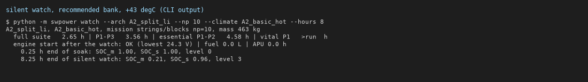

## What is in it

| Part | Where | What it does |
|---|---|---|
| Dossier | `DOSSIER.md` | Needs, ConOps, modes and states, 26 requirements traced to sources and tests, architecture, interfaces, budgets, trade study, M&S plan, FMEA/RBD, V&V and qualification plan, limits |
| Battery model | `swpower/battery.py` | Thevenin block with Peukert, R0(T), capacity(T), lumped thermal and Li-ion heater; built on MIL-PRF-32143C / MIL-PRF-32565 ratings (`tools/derive_battery_params.py`) |
| Bus + sources | `swpower/bus.py`, `sources.py` | Constant-power loads, alternator (speed curve, derating), APU (Willans fuel line), engine idle |
| Mission simulation | `swpower/sim.py` | Phases, combiner, controller in the loop, engine-start check after the watch |
| Thermal | `swpower/thermal.py` | Compartment zone with sol-air roof gain, ventilation, crew, cooling unit COP(T) |
| Transients | `swpower/transient.py` | MIL-STD-1275E and 1275F surge, spike (incl. the 1275F 8.2 uF circuit), starting, ripple and reverse-polarity cases through a TVS + surge-stopper front end |
| Distribution | `swpower/sspc.py` | SSPC I2t / instant-trip curves vs wire damage curves; fault coverage |
| Trade study | `swpower/aoa.py`, `studies.py` | Screening, utility functions, weighted FOM, -10 % sensitivity, random-weight Monte Carlo |
| RMA | `swpower/rma.py`, `data/fmea.yaml` | RBD (k-of-n), Ai/Ao, importance; FMEA with MIL-STD-882E severity |
| Arc-fault detection | `swpower/arcfault.py`, `plc/FB_ArcDetect.st` (+ `.scl`) | 200 kS/s channel-current library (series and parallel arcs, nuisance loads), 5-20 kHz band + dip + burst features, ST trip logic; scored on held-out seeds |
| Controller | `plc/FB_PowerMgmt.st` (+ `.scl`) | Load shedding by priority on the usable SOC band, LVD, fast under-voltage shed, CBRN hold, trip retry/latch, combiner, APU request |

## Figures

| | |
|---|---|
| 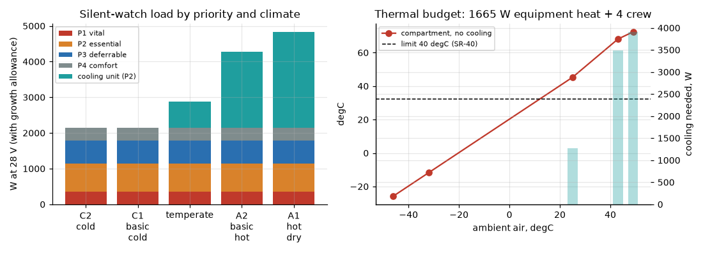 | 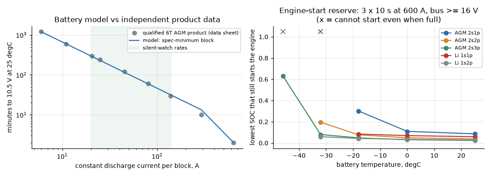 |
| 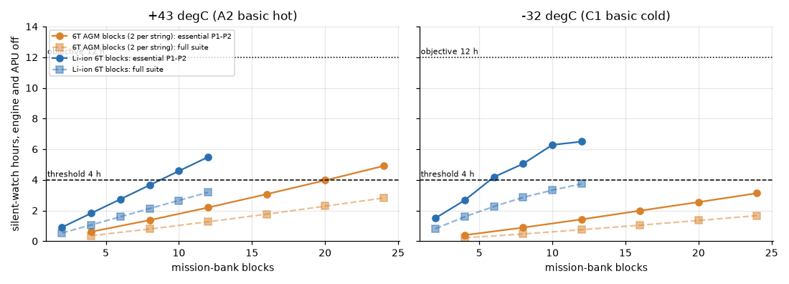 | 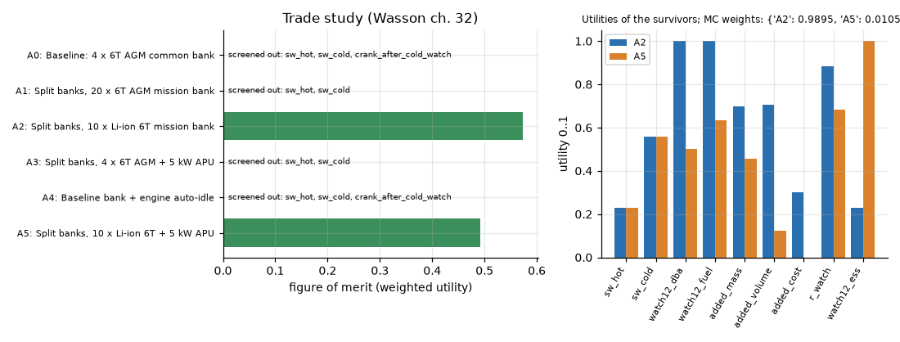 |
| 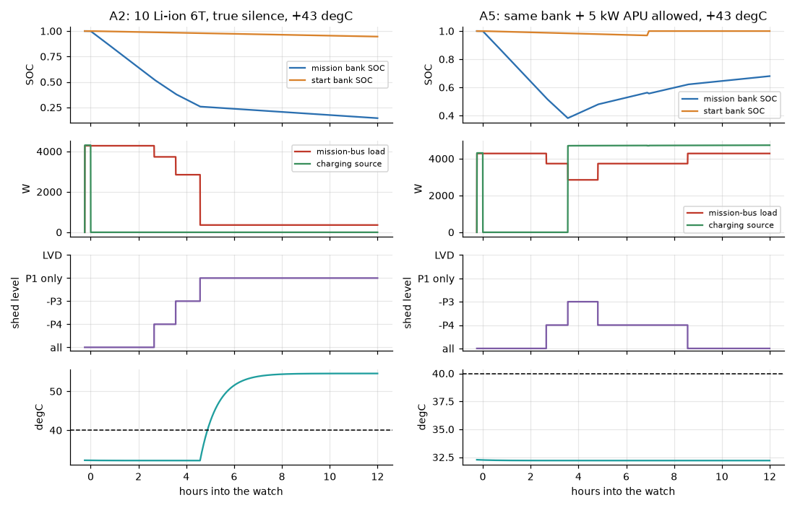 | 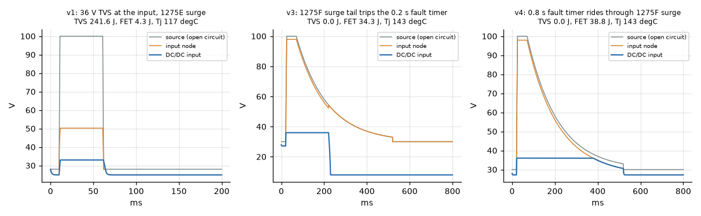 |

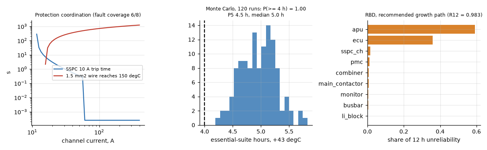
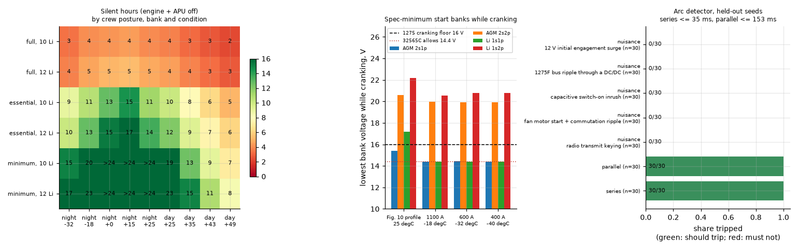

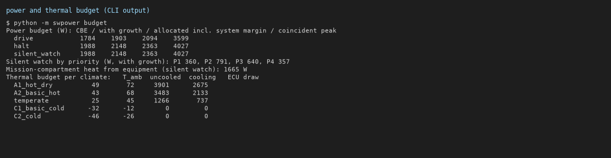
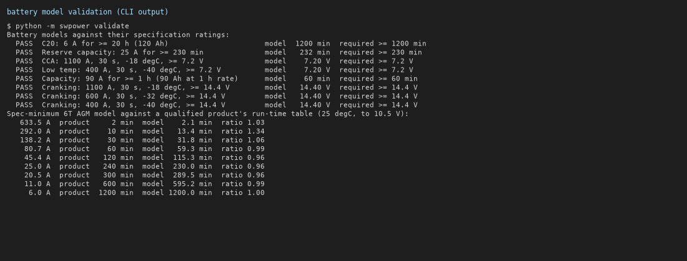

## Limits

Read [DOSSIER section 16](DOSSIER.md#16-limits-and-what-is-assumed-versus-sourced). In short:
- The battery and energy results rest on specifications and are checked against an independent product table.
- The thermal and transient models are physics-based but not validated against hardware.
- Load duty cycles, compartment geometry and failure rates are assumptions. They are swept where they matter.
- The front end and the arc detector are verified in simulation only, not on hardware.

## License

MIT, see [LICENSE](LICENSE).
